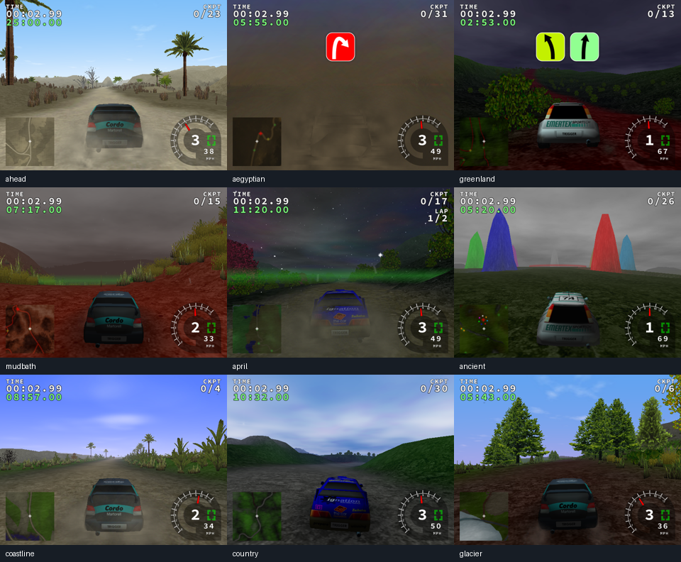

# Phase 0 — executable safety net (gate open)

The safety-net implementation is prepared and verified on the platforms below.
The Reality 0.7 engine migration is not complete. No `phase-0-done` or 0.7 release
tag has been created, and phases 1–9 have not started. The remaining current-image
render-sanitizer limitation is documented below; the latest Linux CI matrix
is still queued/running, while both Windows jobs have passed.

## Delivered

- The complete supplied brief is saved as `docs/CODEX_MASTER_PROMPT.md`.
- Work uses `reality/0.7`; verified commits are delivered directly to `main`, as
  authorized. `v0.6.7-baseline` preserves `7ef9c95b6747a17ea1e39ad56ca893ae50519cbf`.
- CMake/C++17 builds, portable floating-point flags, Linux/Windows presets,
  separate ASan+UBSan/TSan configurations, and a pinned dependency registry.
- GCC/Clang/MSVC/MinGW CI with build/test artefacts, checked with
  checksum-verified actionlint 1.7.7.
- Real-engine replay, fixed-step validation, rolling body-state hashing, capture
  before swap, and frame/per-scope timing and geometry counters. Interactive
  physics, inputs, content loaders and compatibility rendering remain in place.
- An unchanged, pinned MIT doctest dependency; 23 active assertions in one test
  case, plus CLI checks and static legacy-content verification.
- Two generated repository dumps removed; unique docs/licences retained. There
  were no tracked `.d` files in this revision. Stale proprietary Windows audio
  requirements in the build docs now describe the actual OpenAL/ALUT backend.
- A CMake fallback for old profiles whose relative `../data` path no longer
  resolves from the deeper build tree. Configured valid content keeps priority.

## Verification

| Check | Result |
| --- | --- |
| GCC 14.2 release build + CTest | Passed, 4 tests |
| Clang 19.1 release build + CTest | Passed, 4 tests |
| GCC ASan+UBSan and TSan builds | Passed |
| Sanitizer CPU/CLI/content checks | Passed outside the ptrace sandbox |
| Legacy XML definitions / plugin ZIP CRCs | 256 / 25 passed |
| Real-engine scenarios | 13 scenarios, each repeated at 1,500 ticks (6 simulated seconds) |
| Exact framebuffer comparisons | 9 stage images matched between repeats |
| Physics repeats | All 13 rolling hashes matched; 3 fictional vehicle types |
| Refreshed cloud setup smoke | Exact hash and framebuffer match at 1,250 ticks |
| Ordinary interactive CMake startup | Rendered menu with the existing 0.6.x profile |
| First CI Linux matrix | GCC/Clang × release/ASan: all 4 jobs passed |
| Windows MinGW (corrected content) | Build and all tests passed |
| Windows MSVC (C++17/ALUT/ABI corrections) | Build and all tests passed |

The selected terrain maps contain all 16 known legacy material types. This is
coverage of map data, not a claim that the short scripted route touches every
surface. The harness uses the actual TriggerGame/PSim path, with no replacement
physics implementation. One process and fresh profile per scenario isolate
legacy shared static state until Phase 1.

The final accelerated-driving smoke hash is `ba964c871ba9a52b` at 1,250 ticks in
both Release and the sanitized game. The sanitized game reaches that state and
shuts down, then its leak check fails due to the reproduced driver issue below.
The targeted Delta Revised original/corrected-header check also matches at
1,250 ticks, hash `a05f1baa4107d9f1`; its result is saved with the baselines.

## Baselines and measurements

Hashes, environment metadata, both repeat hash files and PNGs are under
[`tests/baselines/linux-gcc`](../../tests/baselines/linux-gcc/manifest.json).
The inventory and surface coverage reports are under `tests/baselines/`.
Legacy warning debt is recorded in `warnings.json`; no warning-free claim is made.

Serial benchmark captures used GCC 14.2, 640×480, llvmpipe (LLVM 19.1.7), Mesa
25.0.7, 1,250 ticks per scenario, with no competing local build/render workload.

| Stage | Mean frame ms | p99 ms | CPU update ms | GPU whole-frame ms | Mean submitted draws | Mean submitted triangles |
| --- | ---: | ---: | ---: | ---: | ---: | ---: |
| Ahead | 22.711 | 31.202 | 0.0305 | 1.203 | 338.4 | 476,736 |
| Greenland | 11.611 | 15.717 | 0.0204 | 0.913 | 210.8 | 121,820 |
| Mudbath | 23.377 | 37.674 | 0.0332 | 1.341 | 774.7 | 280,526 |

Full per-scope CPU/GPU results, p99.9, load time and peak RAM are committed under
[`benchmarks`](../../tests/baselines/linux-gcc/benchmarks/summary.json), with binary
hash and compiler metadata. GPU timestamps are collected after the legacy frame
fence. Counters include submitted degenerate primitives; VRAM is explicitly
`null` because this renderer supplies no reliable portable query. Query overhead
and the legacy `glFinish` affect results. These are correctness/profiling baselines,
not reference-hardware performance claims or an asserted speedup.

## Open gate and limits

- Windows verification passed after correcting C++20-only SDL rectangle syntax,
  ALUT’s MSVC include path and mismatched class/struct ABI declarations. Clang
  now enforces that warning category as an error. The strict Python 3.15 content
  check also exposed Delta Revised’s invalid XML version declaration; its corrected
  header produces exactly the original simulation hash and framebuffer.
  [Verified Windows CI](https://github.com/Saad-programmer/TRackRS/actions/runs/41363622922).
- TODO(PHASE-0): the current cloud GLX driver reports 108,124 leaked bytes in 481
  allocations, reproduced exactly by `tests/driver_probe.cpp` without TrackRS.
  SDL's offscreen driver was also tried and still reported a smaller external
  allocation leak. No leak suppression or disabled sanitizer was used. CI's
  Ubuntu renderer passes the ASan integration run; this cloud-driver limitation
  remains distinct from those passing results.
- The cloud sandbox's ptrace restrictions prevent LeakSanitizer introspection;
  CPU sanitizer checks pass when executed outside that sandbox.
- Reference GPUs, hardware audio and stereo are unverified. No GTX 1060/UHD 620/
  RTX 3070 performance budget is claimed.
- The later all-content 20-second driving gate, long sanitizer soaks, PBR shaders,
  modern GL, content-pack system, new physics and release packaging remain future
  phase work. This report does not count static XML parsing as a playable-stage test.

Reproduction commands are in `docs/BUILDING.md`; current layering is documented
in `docs/ARCHITECTURE.md`. Reusable cloud installation/start instructions were
updated and saved as a draft; saving that draft does not publish a new snapshot.
