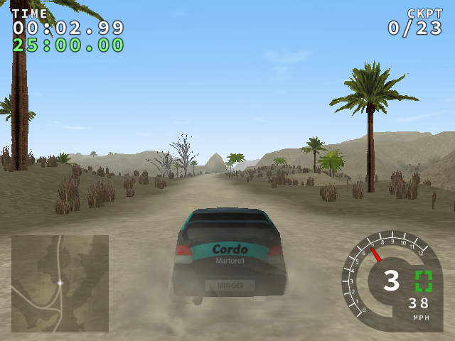
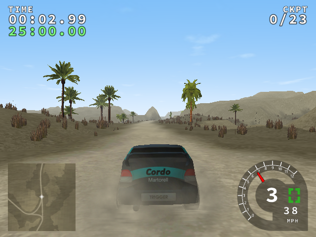

# Phase 1 — defect purge

Phase 1 is accepted and tagged `phase-1-done` at `e7dba16`.
Its final [main CI run](https://github.com/Saad-programmer/TRackRS/actions/runs/41422451771)
passed. The requested audit below precedes the gated [Phase 2a report](PHASE_2A.md).

Phase 0 closed at `18c75bd088a4d1116c11403edf826496916359ca`, with
[green CI](https://github.com/Saad-programmer/TRackRS/actions/runs/41406279839)
before `phase-0-done` was pushed. The allocation-origin policy in ADR 006 remains
unchanged: audited Mesa allocations may have TrackRS callers; TrackRS-origin leaks
remain fatal. `lsan.supp` is deliberately not a native any-frame suppression file.

## Requested Phase 1 status audit

This table assesses the Phase 1 deliverables, not later rendering features in the
master defect descriptions. No **Partial** dependency is carried into 2a.
R-12 was Partial (static fallback only); commit `9d1eab2` closes that gap.

| Item | Status | Implementation commit(s) | Test / evidence |
| --- | --- | --- | --- |
| R-07 | Done | `4e16945`, `732c575` | `tools/pacing_probe.cpp`; retained uncapped/capped JSON: 240 frames in 2.004 s, 18.5 ms CPU. Vsync off/on/adaptive and fallback are in PApp. Stereo multiview is Deferred to renderer migration, not claimed here. |
| R-08 | Done | `732c575`, `fb19301`, `9d1eab2` | `core-primitives`: independent accumulators, bounded catch-up, quaternion and **position + rotation pose interpolation**, endpoints and unchanged input snapshots. `renderStateGame` uses `interpolatePose` and applies its transform only during rendering; physics transforms are never overwritten. Validation intentionally uses exact current poses. |
| R-09 | Done | `732c575` | CMake release build/CI and the three Make forwarding entry points; default compile commands contain O3/ffp-contract=off and no Ofast/native. `-march=native` exists only behind the explicit OFF-by-default `TRACKRS_NATIVE` option. |
| R-11 | Done | `fb19301`, `430c25d` | `core-primitives` edition/schema/vehicle-unlock cases; isolated demo/full/dev SDL UI runs and retained screenshots, including a populated full event list. |
| R-12 | Done | `732c575`, `9d1eab2` | No production `std::system` or ffplay invocation remains. **pl_mpeg is now the in-process MPEG-1/MP2 replacement**; `movie-decoder` tests generated RGB/PCM and rejects invalid input. `tests/test_intro.py` passed real in-window playback and Escape skip. Missing/invalid optional media retains the licensed splash. |
| R-13 | Done | `4e16945`, `732c575`, `430c25d` | PCG reference-vector tests, independent streams, ASan leak canary and 705.8 s ASan/860.0 s TSan soaks; all 13 legacy-RNG A/B hashes restore exactly. clang-tidy unsafe-string canary is rejected. |
| R-14 | Done | `4e16945`, `732c575` | `core-primitives` **wrapCoord/mapSample/periodicCell unit tests** cover zero, exact positive/negative multiples, negative fractions, distant coordinates and invalid periods/nonfinite input; 13-stage A/B isolates these fixes from RNG drift. |
| R-15 | Done | `732c575`, `eebf705`, `b5e76eb`, `430c25d` | GCC/Clang/MSVC/MinGW CI, DEB/ZIP/AppImage/NSIS creation, ZIP/AppImage real render smoke, strict version-parser tests. |
| R-16 | Done | `732c575`, `430c25d` | `module-layering`, actual forbidden-include canary, and configure/build with BUILD_TESTING=OFF. Core/Platform/Renderer/UI/Audio/World/Sim compile separately; application scene composition is explicitly retained until renderer migration. |

The pl_mpeg fixture is generated test content, not a new promotional asset. Put a
licensed MPEG-1 program stream at `data/intro.mpg` to enable playback; MP4 is not a
supported pl_mpeg input. No external player is launched. The existing Phase 1 tag
is historical and is not rewritten by this audit addendum.

## Delivered behavior

| Defect | Phase 1 result |
| --- | --- |
| R-07 | High-resolution frame timing, off/on/adaptive vsync with fallback, optional frame cap, sleep plus final short yield; redundant pre-swap `glFlush` removed. |
| R-08 | Per-PSim accumulator, default 0.004-second step, configurable constructor step, bounded catch-up, reset support; render-only GLM body interpolation. Validation keeps exact fixed ticks and current-state images. |
| R-09 | All Make entry points use CMake; release uses O3, no fast-math, `ffp-contract=off`, x86-64-v2 on x86-64; native instructions opt in, supported LTO enabled. |
| R-10 | Audited, not fabricated: the snapshot has nine fictional and two additional vehicle definitions, with existing meshes. Car Definition v2/calibration remains the explicitly scheduled Phase 4 work. |
| R-11 | JSON `trackrs.edition/1` policy: demo path allowlist, full installed-content access with championship locks, dev unlock bypass. One policy API also governs vehicle unlocks. |
| R-12 | Removed the shell command and external ffplay process. pl_mpeg decodes optional MPEG-1/MP2 inside SDL/GL with skippable playback; the licensed splash remains the fallback. |
| R-13 | Owned subsystem/resource/simulation/game/terrain/particle/audio lifetimes; failed vehicle-type loads release allocations; PCG streams replace all libc RNG calls; ASE token state is per load; unsafe C copies/formatting removed and clang-tidy rejects an unsafe-string canary. LTO also exposed and fixed an inconsistent OpenAL sample class layout. |
| R-14 | Shared bounded wrapping/cell sampling handles exact multiples, negative fractions and distant coordinates; large color/road/surface/height bodies moved out of render.h. |
| R-15 | Single CMake project version generates runtime header, appdata, package metadata and README badge output; DEB/ZIP/AppImage/NSIS use a shared install layout and existing license exclusions. Windows packages include resolved non-system DLLs. |
| R-16 | Separately compiled Core, Platform, Renderer, UI, Audio, World and Sim; typed application state; UI primitives, audio application logic and state dispatch separated; transitive layer guard runs at configure/build even with testing disabled. |

Default launch still shows the legacy TrackRS demo with Ahead available. Set
`data/policy/edition.json` to `full` or `dev` for the corresponding installed-content
policy; no C++ edit is needed. The program version remains 0.6.7 during this
staged migration. This is a foundation update, not a graphics upgrade.

## Hash preservation and explained changes

Original `tests/baselines/linux-gcc/` artifacts were not edited. All 13 pre-RNG
physics hashes and all eight comparable pre-RNG framebuffer hashes still matched
Phase 0. The separately captured ninth Phase 0 Glacier image was not part of that
eight-image repeat set.

The intentional R-13 replacement changes **13/13** rolling physics hashes. Vehicle
wheel bumps and terrain foliage no longer consume or reseed one shared libc RNG
according to render traversal. Vehicle/stage streams and tile-coordinate streams
now have explicit independent state. Legacy stage seeds derive from the virtual
path, optional decimal `stage_seed` overrides it, and validation combines `--seed`.
Cosmetic systems have separate owned streams.

Each new hash below passed two complete 1,500-tick runs (six simulated seconds).
The isolated [legacy-RNG patch](phase1/legacy-rng-probe.patch), applied only to an
experimental source copy, retains the other fixes and restores the original RNG
sites. **Every one of the 13 original hashes returns exactly.** Thus these changes
are attributable to R-13, rather than unexplained accumulator/wrapping drift.

| Stage | Original Phase 0 | Phase 1 | Cause / evidence |
| --- | --- | --- | --- |
| ahead | `8bf21a75413742fd` | `6c59e5730498f6bb` | R-13 PCG streams; original hash restored by RNG-only A/B |
| aegyptian | `8f375462ee59fca0` | `6ef69d2bfba26f27` | R-13 PCG streams; original hash restored by RNG-only A/B |
| greenland | `2cb4462eecf85584` | `804029ba668f1ffb` | R-13 PCG streams; original hash restored by RNG-only A/B |
| mudbath | `6376dec7d8f03b57` | `0aaa524773512bc5` | R-13 PCG streams; original hash restored by RNG-only A/B |
| april | `476ee9b721ac8e9e` | `c04e7703e85bb3b5` | R-13 PCG streams; original hash restored by RNG-only A/B |
| ancient | `65d15b0ed754f2f8` | `e78aa8175f104310` | R-13 PCG streams; original hash restored by RNG-only A/B |
| coastline | `e71e7d78e0f815b6` | `6c1fc7772b1256fa` | R-13 PCG streams; original hash restored by RNG-only A/B |
| country | `7ff5c5f0fe9b19f4` | `826ac4b1dfbe92d6` | R-13 PCG streams; original hash restored by RNG-only A/B |
| darkbushes | `367a39c224d54ab8` | `b6d2c008c0056040` | R-13 PCG streams; original hash restored by RNG-only A/B |
| barren | `00de95e24be1a73b` | `08fa4a1ec9780ada` | R-13 PCG streams; original hash restored by RNG-only A/B |
| altitude | `c965c6916b2d3676` | `12ad3892a6b31069` | R-13 PCG streams; original hash restored by RNG-only A/B |
| arizonachase | `c1567463257d03f3` | `722602d179d1ee7d` | R-13 PCG streams; original hash restored by RNG-only A/B |
| glacier | `5800b5cffe9ae60c` | `a348e60ebf050d09` | R-13 PCG streams; original hash restored by RNG-only A/B |

Evidence: [final repeats](phase1/final-manifest.json),
[pre-RNG repeats](phase1/pre-rng-manifest.json),
[legacy-RNG control](phase1/legacy-rng-manifest.json).
The full suite used frozen candidate `fb19301`; later runtime cleanup changes
only edition/configuration/layer boundaries. A final-head Ahead repeat compares
against the same exact 1,500-tick hash. Comparisons are GCC 14.2/Linux x86-64;
platform-specific compiler/libm equality is not claimed.

Eight final framebuffer captures also matched exactly between repeats. Their
changes from Phase 0 are expected from seeded foliage/effect placement and changed
vehicle trajectories; no art or shader upgrade is claimed.

| Ahead before | Ahead after |
| --- | --- |
|  |  |

## Validation

- Local GCC release and Clang 19 release: 7/7 CTest targets.
- ASan/UBSan: 8/8 CTest targets, including adversarial policy cases and a real
  TrackRS-origin leak canary that remains fatal.
- TSan: 7/7 CTest targets.
- Final ASan/UBSan soak: **705.8 wall seconds**, two stage load/replay/render/unload
  cycles, 5,000 ticks / **20 simulated seconds**, zero application errors.
- Final TSan soak: **860.0 wall seconds**, the same cycle/tick counts, zero reported
  application races. Mesa worker threads are disabled with `LP_NUM_THREADS=0`;
  no race suppression is used. The earlier uninstrumented-worker report is retained
  [verbatim](phase1/tsan-mesa-worker-report.txt).
- Both soaks target at least ten minutes of wall-clock sanitizer execution, not
  ten simulated driving minutes. Their measured domains are explicit in
  [ASan](phase1/soak-asan.json) and [TSan](phase1/soak-tsan.json).
- Native ASan exit status 23 and raw stacks remain visible. Each process accepts
  only the same audited 108,124-byte Mesa allocation origins. See the
  [Ahead audit](phase1/asan-ahead-audit.json) and [Greenland audit](phase1/asan-greenland-audit.json).
- New core/application/renderer code passes clang-tidy. Deliberate unsafe-string
  and upward-include canaries fail. Configure rejects the latter even with
  `BUILD_TESTING=OFF`; a clean no-tests configuration passes the mandatory target.
- Demo/full/dev were launched in isolated profiles against real source content;
  demo keeps locked menu entries, full/dev enter the populated event list. F12
  captures the back buffer before swap and produces nonblank images.
- ZIP and AppImage launched from `/tmp`, used their packaged relative data layout,
  loaded Ahead and produced 31 measured rendered samples. Their reports are
  [ZIP](phase1/zip-smoke.json) and [AppImage](phase1/appimage-smoke.json).
- [Runtime CI 430c25d](https://github.com/Saad-programmer/TRackRS/actions/runs/41419992572)
  passed Linux GCC/Clang release/ASan and Windows MSVC/MinGW, including DEB, ZIP,
  AppImage and NSIS creation. Final main CI is checked again before tagging.

## Measurements and limits

Three reference scenarios ran serially without concurrent build/render work on
Mesa llvmpipe (LLVM 19.1.7), at 1,250 ticks each. These are software-rendered,
instrumented measurements, not reference-GPU budget results.

| Scenario | Archived Phase 0 ms/frame | Phase 1 ms/frame | Same fixes, legacy RNG control |
| --- | ---: | ---: | ---: |
| Ahead | 22.711 | 29.742 | 30.176 |
| Greenland | 11.611 | 13.626 | 13.616 |
| Mudbath | 23.377 | 23.669 | 38.171 |

The new run is slower than the archived sample in all three scenarios. The
same-fixes legacy-RNG control restores each archived benchmark state hash, yet
also shows substantial timing variation. Changed foliage/trajectory work and
shared-host/driver timing prevent attributing these one-shot values to a specific
optimization. No renderer speedup is claimed. Raw [new reports](phase1/benchmarks/summary.json)
and [control reports](phase1/benchmarks-legacy-rng/summary.json) include submitted
primitives, CPU/GPU scopes and memory; VRAM remains unavailable.

The standalone idle-loop pacing probe measured 2,000 ms CPU without a cap versus
18.5 ms CPU over approximately two wall seconds with a 120 FPS cap: 240 frames,
8.35 ms mean interval. This measures idle pacing only, not game FPS. Probe source
is `tools/pacing_probe.cpp`; [uncapped](phase1/pacing-uncapped.json) and
[capped](phase1/pacing-capped.json) results are retained.

The compatibility renderer and stereo's existing separate eye draws remain;
instanced multiview/modern GL is outside the Phase 1 pacing work. Scene/menu
composition remains in the application, while engine modules cannot include the
higher application layer. Simulation remains single-threaded. Hardware graphics,
hardware audio, real-car calibration, long-distance driving endurance and later
phase budgets are not claimed here.

All distributions preserve the previous exclusion of 17 plugin archives marked
unlicensed, while the checkout retains its 25 archives. Existing data/license
credits and dependency notices are installed. No proprietary assets or guessed
car specifications were added. Reproduction commands and tool digests are in
[BUILDING](../BUILDING.md), [tools](../../tools/README.md) and ADR 007–010.
