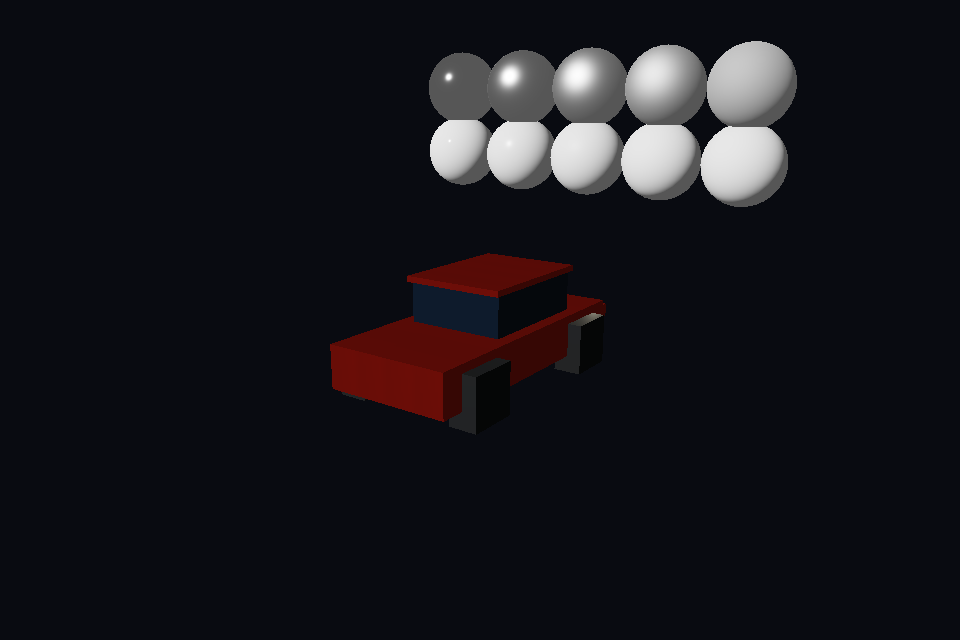
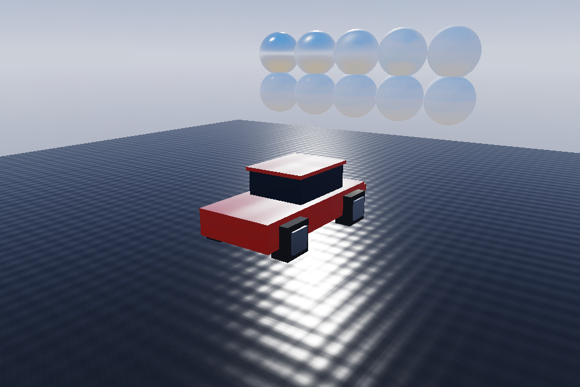

# Phase 2d — native PBR textures and image-based lighting

Native KTX2 material tools, asynchronous texture uploads, baked sky IBL and
scene-aware local car probes are implemented. Legacy content keeps its accepted
look: all 13 simulation hashes and all 8 RGB screenshot hashes are unchanged.
No golden hashes or tolerances were updated. Phase 3 has not been started.

The annotated `phase-2d-done` tag records the final main commit and green CI run.
Until that tag exists, this report describes the release candidate.

## Delivered behavior

- Native BC7 sRGB albedo, BC5 linear normals, BC7 linear ORM (AO/R,
  roughness/G, metallic/B), BC4 scalar channels and BC6H linear HDR cubes.
  Full mip chains are mandatory; material/atlas/transfer validation rejects
  invalid data. Surface maps use anisotropy up to 8× when supported.
- Background parsing/decoding and a three-slot fenced PBO upload ring publish
  complete textures after nonblocking fence polls. Placeholders remain valid
  until release. Independent pinned bcdec provides the BPTC fallback.
- `bake-material` packs channels and compresses native KTX2. The material
  validator checks complete sets. Khronos KTX-Software 4.4.2 independently
  validates all 26 KTX2 assets; all 6 set manifests pass. CI pins its archive by
  SHA 256. Standard glTF PNG fallbacks remain portable; TrackRS's optional native
  cache uses image extras, not an incorrect BasisU extension declaration.
- Deterministic analytic-sky baker produces diffuse irradiance/pi, full GGX
  specular mip chains and a 256² RG16F split-sum BRDF LUT. Results are cached as
  KTX2. Runtime multiple-scatter compensation preserves rough white conductors.
- Cars use a 32² six-face local probe with full GGX filtering, sky and terrain
  capture, no self-capture, and a default 500 ms refresh interval. The API rejects
  intervals below 250 ms. The preview captures its wet floor under the same sky.
- Repeated opaque/masked primitives combine once at upload. Blended primitives
  retain source ordering. Four wheels instance together with shared headlights.
  A referenced-material check permits instancing despite an unused glTF default
  material. No CPU vertex transformation or per-frame VAO definition was added.

See [authoring and tool usage](../PBR_MATERIALS.md),
[design decisions](../DECISIONS.md) and [dependency attribution](../../third_party/bcdec/README.md).

## Demo and measurements

The same-camera comparison shows chrome caps reflecting the sky, clear-coat red
paint with a sharp highlight, rough dark rubber and wet asphalt with sun glint.
The sphere rows sweep roughness 0.1–0.9 for metals and dielectrics.

| Phase 2c before | Phase 2d after |
|---|---|
|  |  |

[Full-resolution side-by-side](phase2d/demo/comparison.png).

The final isolated 120-frame preview uses **15 material draws /9,756 triangles**;
its initial unbatched 2d version used 23 draws for the same geometry. The real
300-tick race records 299 draws per each of paint, glass, rubber and chrome over
299 rendered frames, including all four instanced wheels. Source vertex counts
and triangle counts are preserved by batching.

[GPU time and VRAM report](phase2d/GPU_MEMORY.md) gives every material's measured
GPU timestamps and texture residency, plus cold/warm probe capture/filter costs
in both the preview and real terrain-aware race. Raw arrays and memory scopes
are linked there. These are **llvmpipe software-renderer measurements**, not
hardware performance predictions. Logical texture/depth storage per 32² probe
is 135,136 B; refreshes reuse that storage. Shared environment textures are 417,664 B,
the unique streamed pool 438,604 B and three PBO capacities 350,260 B. Driver padding
and pipeline/geometry storage are explicitly outside per-material texture totals.

## Appendix D acceptance

| Check | Result and evidence |
|---|---|
| GLSL compile/link, all permutations | Pass:16 material variants plus sky, probe filter and background; [shader report](phase2d/checkpoints/shaders.json). |
| IBL white furnace, roughness 0.04–1, metal 0/1 | Pass: production shader,44 cells, clear-coat 0/1 and two views, linear HDR before tone mapping. Max 1.000000119, min 0.999999881; roughness-one loss below 0.00002%, versus 5% limit. The 1.2e-7 excess is single-precision rounding, inside the documented 1e-4 test epsilon. [GPU evidence](phase2d/checkpoints/batching-gpu.json). |
| Mirrored-UV normal handedness | Pass: retained production mirrored sphere and tangent-reference lighting tests, plus MikkTSpace CPU tests; GPU evidence above. |
| Vertex ABI | Pass:56 B Vertex /32 B VertexPacked and offsets asserted in production and tested in the retained Appendix C suite. |
| Attribute definitions only at creation | Pass: PBR attribute pointer calls remain in Geometry construction; per-frame instances update only the existing instance buffer. |
| Material debug views | Pass: F1–F7 /0–6 in preview; retained GPU debug probes cover albedo, normals, roughness, metallic, AO and tangent frame. |
| Visible paint/chrome/rubber/wet asphalt | Pass: final capture visually reviewed against the Phase 2c before image; links above. |
| One car draw per material | Pass: GPU test single and double instances both take 4 draws (144/288 triangles); actual race records 299 submissions per each material. [Runtime evidence](phase2d/checkpoints/game-profile.json). |
| Probe rate /scene /memory | Pass: synthetic clock tests, actual sky+terrain race, all intervals>=250 ms,32² probe 135136 B. Runtime evidence above. |
| Async texture safety | Pass: placeholder-first, complete mip publication, native and forced CPU fallback, malformed-mip rejection and binding restoration; production GPU evidence above. |

## Verification and legacy compatibility

Release CPU 12/12, native ASan/UBSan CPU 13/13 (including the application-leak
canary), expanded strict production clang-tidy, layering and workflow validation
pass. Native sanitized GPU probes, preview and 300-tick real race pass under the
unchanged Mesa allocation-origin audit. TrackRS-origin leaks remain fatal;
`lsan.supp` was not widened. [Sanitizer evidence](phase2d/checkpoints/asan-final.json)
and [CPU/lint logs](phase2d/checkpoints/).

All 13 legacy scenarios ran 1500 ticks /1499 measured frames.
[Manifest](phase2d/manifest.json) matches Phase 2c exactly, including all 8 RGB
framebuffer hashes. The screenshot review has MAE 0, p 99 error 0, SSIM 1 and HUD
error 0 throughout. [Interactive side-by-side review](phase2d/legacy-review/review.html)
and [numeric results](phase2d/legacy-review/review.json). The full paired sheet was
visually inspected. Existing assets, legacy shaders and accepted baselines were
not changed. New PBR scene images intentionally change through IBL; they are not
substituted for legacy goldens.

A WIP commit was pushed after every completed item. The recovery history and
commands are retained in [PHASE 2D_WORKLOG.md](../PHASE 2D_WORKLOG.md). Main merge
and gate tag require the final candidate CI to pass; final main CI is verified
before publishing the gate tag. The next authorized boundary is the end of 2d.
