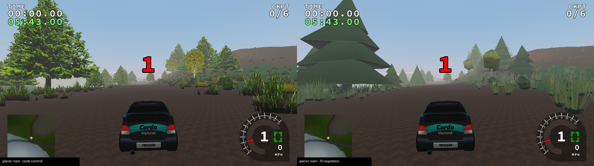
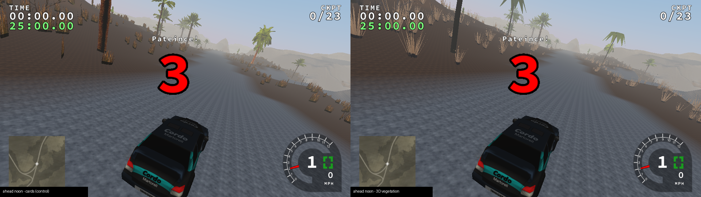
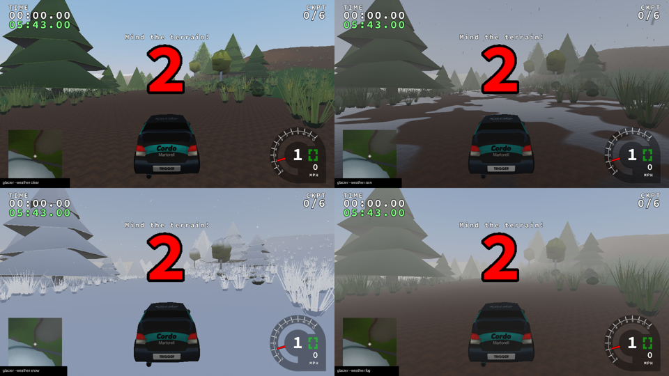
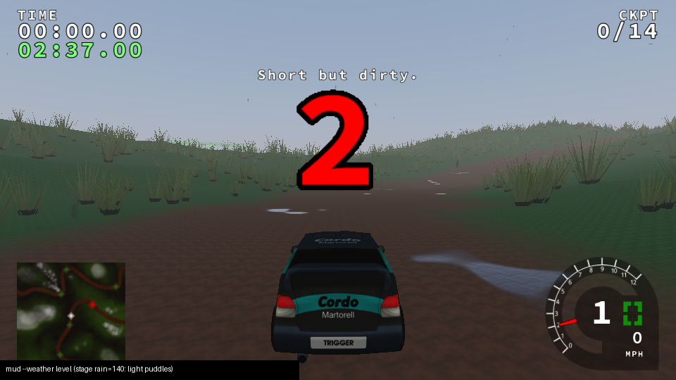

# Phase 3c — world dressing: vegetation and weather

Status: **in progress.** Item 1 (instanced 3D vegetation) and item 2 (weather
surfaces, puddles, snow cover, overcast sky, stage fog) are done. Remaining:
water reflections, road ribbon, night headlights; post-FX is Phase 3d. No `phase-3c-done` tag is warranted yet.
Legacy remains the default renderer; nothing in the Legacy path changed.

## What shipped

Select **World renderer: PBR**, then **Vegetation (PBR): 3D / Cards** in Options.
The setting persists as `graphics.vegetation="3d|cards"`; on the command line use
`--vegetation 3d|cards`. 3D is the default whenever PBR is selected.

* **Procedural, original plants.** Six forms (conifer, broadleaf, bush, grass,
  palm, cactus), each with three mesh LODs generated in code
  (`engine/vegetation/vegetation.cpp`). No imported meshes or textures.
  The plants use 24-byte vertices (packed normal, RGBA8 colour/AO, unorm16 UV)
  and 16-bit indices:

  | form | LOD0 | LOD1 | LOD2 | LOD3 |
  |---|---|---|---|---|
  | conifer | 166 | 64 | 10 | card (4) |
  | broadleaf | 420 | 116 | 26 | card |
  | bush | 400 | 108 | 20 | card |
  | grass | 28 | 14 | 6 | card |
  | palm | 144 | 78 | 40 | card |
  | cactus | 80 | 56 | 20 | card |

  (triangles per plant; the impostor uses the band's sprite with `sprite_count`
  crossings, the same layout as the legacy card.)
* **Data-driven species.** `data/vegetation/species.json` maps all 62 shipped
  sprites to a form, a colour and a silhouette width.
  `tools/bake_vegetation_species.py` regenerates it, and a CTest fails if it is stale.
  The colour is the mean of the brighter half of the sprite's opaque texels.
  The width is the sprite's opaque bounding-box width. Twenty-three bare, sparse
  or silhouette sprites stay instanced cards at every distance rather than
  receiving an unfaithful form (listed in `docs/ASSETS_TODO.md`).
* **Placement and physics unchanged.** The renderer reads the existing seeded
  `PTerrainFoliage` arrays in place through a byte stride, and a `static_assert`
  pins that layout. Collision rigidity and contacts are untouched; identical
  replay hashes prove it (below).
* **LOD without popping.** Each plant picks LOD0..2 or the card impostor by
  distance (High: 40 / 90 / 160 / 300 m; per-quality table in `rangesFor`). In
  the last 15 % of each range the outgoing and incoming LODs draw complementary
  screen-door pixel sets: interleaved gradient noise, with the fade code carried
  per instance. There is no blending and no sorting, and every pixel is covered
  exactly once (unit-tested).
* **Instancing.** One `glDrawElementsInstancedBaseVertex` per non-empty
  (band, LOD) bucket. Each pass uploads its instances with one orphaned
  `glBufferData` and one `glBufferSubData` into a 32 B/instance stream. The
  classifier and staging buffers reuse capacity, so steady state does not
  allocate.
* **Shading.** Plants go through `pbr.frag` compiled with `VEGETATION`, so they
  share the sun, sky IBL, CSM receiving and height fog with terrain and cars.
  Additions:
  * sky-bent foliage normals;
  * a bounded thin-leaf transmission term (`uTranslucency` ≤ 0.35);
  * no back-face normal flip, because plant normals are view-independent;
  * sRGB decode for the legacy UNORM sprite cards, matching the existing
    world adapter.

  `ALPHA_TO_COVERAGE` is used automatically when the framebuffer is multisampled.
  Otherwise cards use the alpha test.
* **Wind.** Height²-weighted sway with per-plant phase, scaled per form (grass
  bends most, cactus barely moves). It is driven by a new deterministic
  `TriggerGame::animationtime` that advances every tick, including the countdown,
  and never feeds physics.
* **Shadows and probes.** Trees, bushes, palms and cacti cast into every CSM
  cascade, using LODs from the main camera. Grass casts no shadow. Reflection
  probes draw impostors only, within 160 m.

## Verification

* `vegetation-cpu` (doctest, 7 cases, ~116k assertions):
  * every shipped sprite has a catalog entry, and invalid catalogs are rejected;
  * meshes have no degenerate triangles, unit normals, roots at the ground,
    height ≈ 1 and stay inside the cull sphere;
  * triangle counts fall strictly at every LOD;
  * closed shells face outwards;
  * generation is deterministic per seed;
  * cards match the legacy UV/corner order;
  * LOD choice is monotonic and the dither pairs cover every pixel exactly once;
  * the classifier culls, conserves instance counts, skips grass in shadows and
    uses impostors only in probes.

  These tests caught three real defects before integration (see the worklog).
* `pbr-shader-permutations`: four new `VEGETATION` × `USE_CSM` ×
  `ALPHA_TO_COVERAGE` pairs compile and link with glslang.
* `vegetation-species-fresh`, `module-layering` (now covering
  `engine/vegetation`) and all 17 CTest tests pass. The production clang-tidy
  set now includes both vegetation sources, and they are clean.
* `tests/run_world.py` now also runs a `noon-cards` control. For 3D runs it
  asserts:
  * meshes are drawn;
  * one main vegetation pass per frame and one per cascade;
  * memory budgets: mesh < 4 MB, instance stream < 8 MB;
  * the cards selection never runs the 3D path.

  Medium 640×480 and High 1280×720 runs pass. Legacy, noon/night CSM, Blob and
  Cards all produce the identical physics hash `72d1a3ffd170d57c`
  ([world-high.json](phase3c/world-high.json)).
* **Legacy unchanged:** an A/B of the unmodified base binary against the new
  binary, both built in this container, gives 13/13 stages with identical state
  hashes and identical framebuffer SHA-256 ([legacy-ab.json](phase3c/legacy-ab.json)).
  The committed `tests/baselines/linux-gcc` manifest was not used as the
  reference: this container's GCC 13 toolchain reproduces different legacy hashes
  for the *unmodified* base commit too. That manifest was left untouched.
  After the last source change, the final binary was re-run on ahead and glacier
  and again matched the base exactly.

## Images and costs

Measured on glacier at 960×540 High noon with CSM, 750 ticks, on Mesa llvmpipe
([glacier-metrics.json](phase3c/glacier-metrics.json)):

| metric | cards | 3D |
|---|---|---|
| draw calls per frame | 638.3 | 453.1 (−29 %) |
| triangles per frame | 774,804 | 781,000 |
| frame mean (software) | 516 ms | 541 ms (+4.8 %) |

The last 3D frame classified 92 / 460 / 759 / 1400 instances into LOD0..3, with
367 cross-fading, using 20 main-view draws. Mesh storage is 83 KB and the
instance stream 100 KB. Instancing consolidates the per-tile, per-band card
draws; the added cost is mostly the volumetric shadow casters. Software timings
cannot certify the §7 hardware budgets. Please measure with
`--vegetation 3d` and `--vegetation cards` on real GPUs, using the Phase 3b
hand-off command.

## Known gaps (honest assessment)

* The forms are stylised low-poly volumes. Close up they read as volumes with
  correct parallax, lighting and shadows, but they lack the leaf-level detail of
  the photographic sprites. Textured leaf-card clusters and bark need authored or
  licensed foliage textures, which are not in the repository.
* The LOD dither is visible on still frames in the cross-fade band. Temporal AA
  (a Phase 3 post-FX item) will resolve it.
* Probes use impostors only, and grass casts no shadows. Both are budget
  choices, not omissions.

# Item 2: stage weather in the PBR world

Before this item, the PBR path ignored each stage's `<weather>` (rain, snowfall,
fog density) except for the legacy precipitation particles, and its height fog
used a constant density. Now one CPU `Weather` state (`engine/world/atmosphere`)
drives every PBR pass:

* **Source.** `weatherFromLevel(rain, snowfall, fogdensity)` maps the stage's
  legacy attributes to wetness, puddles, snow, overcast and fog density. The old
  default fog density (.01) maps to the Phase 3b constant (.003 /m). Players can
  override it with **Weather (PBR): Stage / Clear / Rain / Snow / Fog**
  (`graphics.weatherpreset`, `--weather level|clear|rain|snow|fog`). A preset
  also sets the precipitation particle rates; these are cosmetic and use their
  own effects RNG.
* **Surfaces** (`pbr.frag`, all permutations, in world space so cars, plants and
  terrain agree):
  * the water film darkens porous albedo and adds a moderate sheen;
  * puddles form only on flat (n·z > .96) tarmac, gravel, dirt and mud texels,
    from a two-octave world-space noise mask. They are mirror-smooth with flat
    normals, so they reflect the sky IBL and the sun glint;
  * snow whitens and roughens upward-facing surfaces, including tree crowns;
  * leaves get only a light wet sheen, so wet forests don't turn silver.
* **Sky and light.** Cloud cover attenuates the direct beam (by up to 85 %),
  greys and brightens the sky dome, hides the sun disc, stars and moon, and
  raises ambient light. The sky IBL rebakes when cloud cover changes. Fog density
  comes from the weather state.
* **Physics is untouched.** Grip on wet or snowy surfaces belongs to Phase 6's
  surface μ table. The world runner proves the physics hash is identical for
  Stage, Rain, Snow and Clear (`72d1a3ffd170d57c`,
  [world-weather.json](phase3c/world-weather.json)).

Tests: two new doctest cases (level mapping is bounded and monotonic,
non-finite inputs are rejected, preset values, cloud-cover radiance), and new
weather assertions in `run_world.py`. All shader permutations compile.

Known gaps: rain streaks, windscreen droplets, splashes and lightning are not
implemented (the legacy rain particles remain). Weather is static for a stage;
dynamic transitions are backlog §8.1. The legacy cards/basic shader path (Legacy
renderer, retained legacy car meshes) does not receive wetness or snow.
