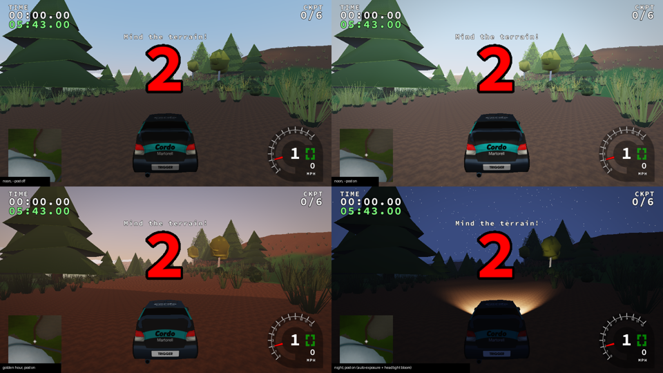

# Phase 3d — HDR post-processing (core)

Status: **in progress.** The HDR target and the first post chain (auto-exposure,
bloom, ACES tone map, vignette) are done. SSAO/GTAO, TAA/SMAA, motion blur,
depth of field, colour-grading LUTs and screen-space reflections are not started.
The Legacy renderer is still the default; PBR is selected in Options.

## What shipped

With **World renderer: PBR** and **Post FX (PBR): On** (default; `graphics.post`,
`--post on|off`):

* **Linear HDR scene.** `trackrs::post::begin()` binds an RGBA16F colour target
  and a DEPTH24 *texture* (ready for SSAO/DoF/SSR). The world's existing
  `linearCapture` switch makes every PBR pass write linear light, as the IBL
  probes already did: terrain, cars, plants, sky, water and retained legacy
  geometry. The HUD is drawn after the resolve, so it is never tone-mapped.
* **Auto-exposure without read-back.** A centre-weighted log-luminance pass at
  64×64 feeds a mip chain whose 1×1 level is the geometric mean. A 1×1 R32F
  ping-pong pass adapts it over time: exponential and frame-rate independent,
  faster when it gets brighter (3/s) than darker (1.2/s), driven by the
  deterministic animation clock. Exposure = key (0.16) / adapted, clamped to
  0.35–3.
* **Dual-filter bloom.** Six half-resolution R11F_G11F_B10F levels; the first
  downsample applies a soft-knee bright pass (threshold 1, knee 0.5) with a
  Karis weight against fireflies. Tent upsamples add back up the chain.
  Intensity is 0.06 after exposure.
* **Composite.** The Narkowicz ACES fit and gamma 2.2 (the same curve every pass
  used before), plus a light vignette. One composite draw into the frame's
  original framebuffer.
* **Reference math in C++.** `engine/post/exposure.{h,cpp}` holds target
  exposure, adaptation, the bloom chain and the soft-knee prefilter. The shaders
  mirror these functions, and `post-exposure-bloom` (doctest) pins them:
  * exposure is clamped and non-finite inputs are safe;
  * adaptation over 50 small steps equals one large step, so it is
    frame-rate independent;
  * the bloom chain sizes and the prefilter curve match.

## Verification

* All 18 CTest tests pass. All post shader pairs compile and link with glslang.
  The production clang-tidy set includes both post sources and is clean.
* `tests/run_world.py` runs a `noon-nopost` control and asserts that:
  * post resolves once per frame with bloom levels;
  * the `post` pass runs once per frame;
  * disabling it removes the pass.

  All nine cases share physics hash `72d1a3ffd170d57c`
  ([world-post.json](phase3d/world-post.json)). The CI terrain and PBR
  integration runners pass with post on by default.
* An ASan/UBSan build drew swamp (water, 3D plants, rain, night headlights, post)
  with no sanitizer errors. Leak reports in this container show only
  SDL/dbus/driver allocations, the same as the untouched Legacy case. The repo's
  LSan audit policy rejects those unsymbolised driver frames here, so the
  audited ASan gate is left to CI.
* Legacy A/B (ahead, coastline): identical state and framebuffer hashes.
* Found and fixed during bring-up: `begin()` captured the "previous" framebuffer
  after lazily creating its own targets. Creating a target binds it, so the
  first resolve went into a 1×1 texture and the screenshot read failed under the
  fatal KHR_debug check.

Memory at 960×540: HDR colour + depth 6.2 MB, bloom chain 0.7 MB, luminance and
adaptation targets < 10 KB. That is about 2 + 2×6 fullscreen passes per frame,
mostly at quarter resolution or smaller. Software timings are not hardware data.

## Known gaps

SSAO, TAA (which will also resolve the vegetation LOD dither), motion blur, DoF,
colour LUTs and SSR. The Legacy renderer stays the default until those land and
real-GPU measurements confirm the §7 budgets.
