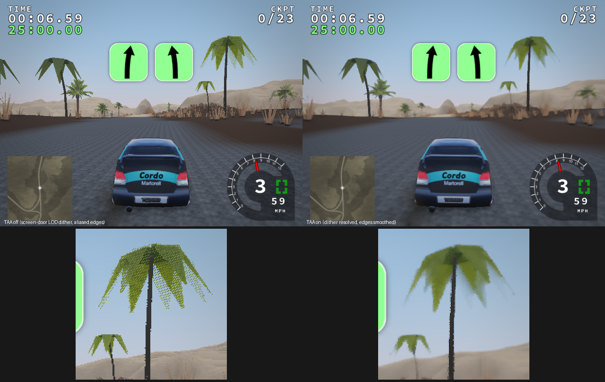

# Phase 3e: temporal AA and the golden-manifest regeneration

Order: amendment §A9.1, after A0. Item 1 (TAA) is done. Item 2 (the baseline
regeneration) is a separate commit; its source run and toolchain are recorded
in [`tests/baselines/linux-gcc/REGENERATED.md`](../../tests/baselines/linux-gcc/REGENERATED.md).
The default renderer stays Legacy (A0.3).

## 1. TAA (PBR world, `graphics.aa`)

| Part | Implementation |
|---|---|
| Jitter | Halton(2,3) sub-pixel offsets over an 8-frame cycle (`post::taaJitter`), applied as a clip-space translation to the **scene projection only**. The HUD, shadow cascades and reflection probes keep their own projections. Unit-tested: the shift equals the requested pixels and depth is untouched. |
| Static scenery | Reprojected per pixel from the scene depth through the current *jittered* inverse view-projection and the previous *unjittered* view-projection, honouring the game's `glDepthRange(0, 0.999)`. |
| Moving objects | Cars write motion vectors (previous minus current NDC, flag in `b`) in a velocity pass, `car::drawVelocity`. The pass shares the scene depth (LEQUAL, no depth write) and uses each car's body and wheel transforms from this frame and the last. Cars not drawn in a frame lose their history. |
| Resolve | `post/taa.frag` runs first in `post::end`, so exposure, bloom and SSAO all see the anti-aliased frame. Steps: 3×3 neighbourhood box in YCoCg with a Reinhard weight; history clamp; Karis luminance-weighted blend with feedback 0.9; history reset on resize, on the first frame, and at screen-edge disocclusions. History is an RGBA16F ping-pong. |
| Sharpen | A 4-tap unsharp mask in the composite (strength 0.25, clamped non-negative), only while TAA runs. |
| Dither resolve | The vegetation and people LOD screen-door noise now rotates by the golden ratio every TAA frame (`uTemporalFrame` through `world::apply`). Both LODs share the pattern, so they stay complementary. The resolve averages the pattern into a smooth cross-fade. Without TAA the pattern is static, exactly as before. |
| Controls | Config `aa="taa\|off"`, `--aa taa\|off`, Options "Anti-aliasing (PBR)". Default on, effective only with PBR post-processing. |
| Cost | One fullscreen pass plus one velocity draw per car part. Memory: two RGBA16F history targets plus an RGBA16F velocity target, 24 B/px (7.4 MB at 640×480, 49.8 MB at 1920×1080). |

### Harness addition: `--render-from N`

* **What it does:** simulates ticks `[0, N)` without drawing, then renders.
  Long runs (M2's gravel stage, TAA motion evidence) become affordable under
  software GL.
* **Why it is safe:**
  * Physics never depended on rendering. The same replay with `--aa taa`
    and `--aa off`, both from tick 2340, gives the identical state hash
    `a05733e9c6383ffa`, and the world runner's hash is unchanged in every case.
  * Car wear (dust, mud, brake heat) now advances **per simulation tick**
    (`car::observe`, called from the game tick), so skipping frames cannot
    lose it. The draw-time update remains only as a fallback.

### Evidence

New replay: `tests/replays/drive_vegetation.csv`, driving the opening straight
of "ahead". The car is at 59 mph; rendering runs from tick 2340 to 2400.

* **Left:** TAA off. Note the screen-door dither on the palm in LOD
  transition (zoomed below) and the stair-stepped trunks.
* **Right:** TAA on. The dither resolves into a smooth fade and the edges are
  anti-aliased. The car stays sharp because of its motion vectors.
* **Cost visible in the image:** the moving road texture softens slightly.
  This is the usual trade-off of a 0.9-feedback resolve.

### Validation

| Check | Result |
|---|---|
| `post_tests` (new TAA jitter case) and full `ctest` | pass |
| `run_world.py` (adds a `noon-noaa` control) | all pass, physics hash `72d1a3ffd170d57c` everywhere. Asserted: TAA resolves every frame after exactly one history reset; one velocity pass per frame; at least 5 car velocity draws per frame; nothing runs with `--aa off`. |
| PBR shader permutations, layering | pass |
| clang-tidy production lint | pass |
| Legacy A/B vs base | see the commit message of this change |

## 2. Golden manifest regeneration (separate commit)

* **The problem:** the committed `tests/baselines/linux-gcc/manifest.json`
  came from the older Phase 0 toolchain. The CI toolchain reproduces
  different legacy hashes for the unchanged game code.
* **Why existing runs could not supply it:** the regular CI replay step runs
  only `--quick` (one stage, 1250 ticks), so no CI artifact held a full
  manifest.
* **New workflow:** `.github/workflows/baselines.yml` is dispatch-only. It
  builds with the CI toolchain, runs the complete legacy baseline (13 stages,
  1500 ticks, two repeats), records the toolchain, and prints the manifest
  into its job log. Build sessions cannot download artifacts (blob storage is
  outside their network policy), but they can read job logs.
* **The regeneration commit:** it contains only the new `manifest.json` and
  [`REGENERATED.md`](../../tests/baselines/linux-gcc/REGENERATED.md), which
  names the run (43184978914), base commit (`f1b4015`) and toolchain (Ubuntu
  24.04.5, GCC 13.3.0, Mesa 25.2.8 llvmpipe). No game code changed.
* **Cross-check:** the CI manifest is identical, state and framebuffer
  hashes, to a local build of the pre-3e base `ec087af` made in this
  container.
* **Exact comparison:** from the next commit on, the g++ release CI job
  compares three stages with framebuffers (`ahead`, `aegyptian`, `greenland`)
  **exactly** against the manifest: the "Golden manifest (exact)" step. The
  same comparison passes locally on the M0 build.
