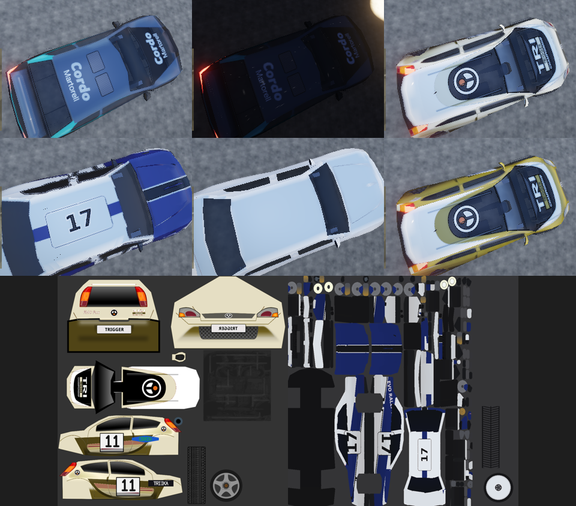

# Phase 4b: car rendering (gate)

Status: **done. Stopped at the gate for maintainer review.** 4c (damage
visuals) has not started. The Legacy renderer is still the default and is
untouched. Legacy hashes and framebuffers match the base build (A/B below).

## What shipped

`engine/car/` holds two parts:

* `car_assets.{h,cpp}`: the CPU half, with no GL. It is unit-tested by
  `car_assets_tests` (8 cases).
* `car_renderer.{h,cpp}`: the GL 3.3 half. It draws through `pbr.frag`
  compiled with a new `CAR` permutation and `data/shaders/pbr/car.vert`.

The game routes a vehicle to it from `trackrs::Renderer::car()` when the PBR
world scene is active and the car renderer is enabled. Otherwise the original
`vehiclePart` path runs unchanged.

| Requirement | Implementation |
|---|---|
| **CarRenderer with LODs** | Three index LODs (meshoptimizer simplifier, attribute seams locked, sloppy fallback, never coarser-with-more-triangles). They are chosen by the projected size of the bounding sphere; the shadow pass uses LOD ≥ 1. One VBO plus one concatenated IBO per car type. |
| **Wheels as separate rotating nodes; suspension-linked** | Each wheel is its own draw, using the physics wheel frame `PVehiclePart::wheel[i].ref_world`, which already composes spin, steer and suspension travel (`ride_pos`). It is scaled by `wheelscale × radius` exactly like the legacy path. |
| **Emissive head, tail and brake lights** | A light map derived per texel: tail and brake lamps come from the shipped emission map's alpha; headlamps are bright, detailed white texels in the front of the body. Tail lamps glow when lights are on (night, dusk or heavy overcast via `world::headlightsOn`) and much brighter under braking. Headlamps glow when lights are on. The existing scene spot lights still throw the beams. |
| **Brake-disc glow at night** | Per-vehicle disc temperature model (`updateWear`): heats with braking power and front/rear bias, then cools towards ambient. `brakeGlow` gives a dull red from about 350 °C and full glow by about 650 °C, drawn as an emissive annulus behind the spokes. It is emissive, so it reads at night. |
| **Livery: paint mask, number and decals, sponsor atlas** | A role map derived per texel: R paint (the paint mask), G glass, B rubber, A metal. Optional `livery.json` (`trackrs.livery/1`, documented in CAR_DEFINITION.md): recolours paint near measured source colours while keeping shading, redraws race numbers in an original stroke font, and fills sponsor slots with **procedurally generated fictional logos** (seeded emblem plus generated name, e.g. "TRIIKA"). Composited once per car type on the CPU. |
| **Dirt and mud accumulation shader** | `Wear.dust` and `Wear.mud` grow with distance driven on loose surfaces (mud when wet) and are rinsed by rain. The surface comes from the terrain map under the car. The shader masks dirt low on the body, sprays it behind the wheels, breaks it up with noise, and raises roughness and lowers metalness under it. |
| **Clear-coat paint** | Paint-role texels get the PBR clear-coat lobe, reduced under dirt. |
| **Glass pass** | Glass texels are discarded from the opaque pass and redrawn in a second blended pass (no depth write): dark tint, mirror-smooth, alpha 0.86. |
| **Interior with working gauges** | Procedural cockpit with dash, instrument cluster, two seats and a roll cage. It is kept under a roof height and width **measured from each body mesh** (`measureCabin`, robust to roof scoops and low-poly layouts). Tacho and speed needles are rotated in the vertex shader from live RPM (sweep scaled to the engine's own max RPM) and speed. |

### Liveries for the 11 placeholder real cars

`tools/seed_liveries.py` writes plain, **fictional** colour schemes and
numbers, chosen to avoid recognisable team or sponsor liveries (§2.4). The
`car-liveries-fresh` test checks the files are up to date.

* **Fox-bodied cars:** the measured fox number panels are redrawn with new
  numbers, and two sponsor slots receive generated logos.
* **Evo-bodied cars:** the evo_rally number panels are split across UV
  islands, so these cars are only recoloured and keep the atlas's "17". This
  is stated rather than faked.

Real-world specs are untouched; the liveries are artwork only.

### Supporting changes

* `mesh::Material::emissive` (from `map_Ke`) and `ImportOptions::assetRoot`.
  Six shipped MTLs reference sibling emission maps via `../`, so car imports
  may reach `/vehicles`. Everything else keeps the model-directory restriction.
* `PEngine::getMaxRPM()` is a read-only accessor for the tachometer sweep.
* Controls:
  * config `cars="on|off"`;
  * `--cars on|off`;
  * an Options entry, "Car renderer (PBR)";
  * validation pass scopes `cars` and `shadow_cars`;
  * report `<json>.cars.json`.
* Tools:
  * `tools/car_render_report.py` for per-car measurements;
  * `tools/seed_liveries.py`.

## Validation

| Check | Result |
|---|---|
| `ctest` (release) | all pass, incl. `car-assets` (8 cases) and `car-liveries-fresh` |
| `check_pbr_shaders.py` | 16 permutations compile and link (adds `car`) |
| clang-tidy production lint (warnings as errors) | pass |
| layering (`engine/car` added) | pass |
| `tests/run_world.py` (legacy, noon/night CSM, blob, cards, no post, no crowd, **no cars**, rain, snow, clear) | all pass, physics hash `72d1a3ffd170d57c` in every case. With cars on: one car type and one vehicle drawn; LODs monotonic; cabin measured; VRAM < 32 MB; `cars` pass once per frame; `shadow_cars` once per cascade per frame. With `--cars off`: no car pass and no report. [world.json](phase4b/world.json) |
| Legacy A/B (`run_baselines.py --compare`, base `ec087af` built in this container) | all stages pass, identical to base; the Legacy path is not touched |

### Bugs found and fixed while bringing it up

* **Atlas V flip.** OBJ UVs put v = 0 at the image bottom, so images are now
  uploaded bottom row first. Before this, the roof sampled the door art.
* **Emission alpha.** Shipped emission maps keep RGB everywhere and mark lamps
  only in alpha. Before this, the whole fox body glowed red under braking.
* **Saturated darks.** Deep red or navy texels have low luma; they are now
  paint, not rubber. Before this, evo red could not be recoloured.
* **Roll cage.** It poked through low and scooped roofs. It is now measured
  from the mesh.

## Per-car GPU time and VRAM

Full table: [phase4b/cars.md](phase4b/cars.md); data in
[phase4b/cars.json](phase4b/cars.json). Measured by
`tools/car_render_report.py` at 640×480, medium quality, CSM, noon, stage
"ahead", baseline replay, 24 frames.

* **VRAM** is the renderer's own accounting of everything it uploaded for
  the car type: VBO/IBO with 3 LODs, interior, and albedo, role and light
  textures with full mips.
* **Time** is per frame:
  * the main-view `cars` pass;
  * the `shadow_cars` pass across all cascades.

| body family | cars | VRAM per car | of which textures | body tris LOD0/1/2 | main-view draws / tris | `cars` CPU ms | `shadow_cars` CPU ms |
|---|---|---|---|---|---|---|---|
| cordo (kitcar, super500, wrc) | 3 | 13.38 MB | 13.33 MB | 694 / 347 / 150 | 7 / 2156 | 0.51–0.54 | 0.57–0.61 |
| evo kit/super500/wrc ("Zaibatsu") | 3 | 13.38 MB | 13.33 MB | 616 / 308 / 265 | 7 / 2000 | 0.52–0.74 | 0.58–0.64 |
| fox (kitcar, super500, wrc) + 4 placeholders | 7 | 13.38 MB | 13.33 MB | 634 / 316 / 302 | 7 / 2036 | 0.47–0.56 | 0.55–0.70 |
| evo_rally + 7 placeholders | 8 | 13.53 MB | 13.33 MB | 2946 / 1472 / 437 | 7 / 8772 | 1.22–1.42 | 1.19–1.36 |
| lancer_evo | 1 | 13.50 MB | 13.33 MB | 1906 / 953 / 411 | 7 / 8548 | 1.19 | 1.31 |

**How to read the timings.**

* These numbers come from **llvmpipe (software GL)**. The CPU column is the
  pass's wall time, which under llvmpipe includes the software rasteriser's
  queueing. The GL timer queries are recorded in `cars.json`, but on llvmpipe
  they read around 0.0001 ms and do **not** measure rasterisation.
* **Real-GPU numbers are still owed.** Run
  `tools/car_render_report.py --binary <hardware build>` on the target GPU;
  no hardware figure is claimed here.

**Observations:**

* **Textures dominate VRAM.** The figure is 1024² sRGB albedo, an RGBA8 role
  map and an RG8 light map, each with full mips.
* **Two easy reductions** (not done yet):
  * share role and light maps between car types that use the same atlas,
    e.g. cordo_wrc and cordo_super500;
  * pack the role map into RG8.
* **Fox LOD2.** The simplifier cannot get the fox body below about 300
  triangles at 15 % because of its seams, so its LOD2 ≈ LOD1.

## Evidence

* **Top row:**
  * Cordo at noon (clear-coat, metal and rubber roles; tail lamps lit under
    the start-line brake);
  * the same car at night (tail lamps emissive, headlamp beam ahead);
  * Porsche 911 SC RS placeholder on the fox body, with a fictional cream
    livery.
* **Middle row:**
  * Peugeot 205 T16 E2 placeholder on the evo body, recoloured navy (keeps
    "17");
  * Lancer Evo (white in Legacy too: its atlas is a palette texture);
  * fox_wrc as authored.
* **Bottom:** the composited atlases.
  * Fox/Porsche: race number 11 and two generated fictional sponsor logos.
  * Evo/Peugeot: recolour only.

## Not covered or limitations (honest list)

* **Brake glow, dust and mud are not in a screenshot.** The 1-second baseline
  replay neither drives far on gravel nor brakes hard enough. The models are
  unit-tested: discs exceed 300 °C under hard braking and then cool; dust
  builds on dry gravel and mud when wet. The shader paths compile and run in
  every frame. A longer stage replay capture belongs with 4c, where damage
  needs one anyway.
* **No side or cockpit camera in the headless harness.** The needles and the
  door numbers are verified by unit tests and the atlas composite, not by an
  in-car capture.
* **Role classification is heuristic.** For example, some dark navy lower-body
  texels on the cordo read as rubber, i.e. rougher with no clear-coat.
  Authored role maps would replace it when licensed models arrive (4d).
* **Headlamp texels vs beams.** Headlamp detection relies on bright texels at
  the front of the body. The beams are the existing scene lights.
* **Default renderer not flipped.** It waits for the maintainer's real-GPU
  numbers.
