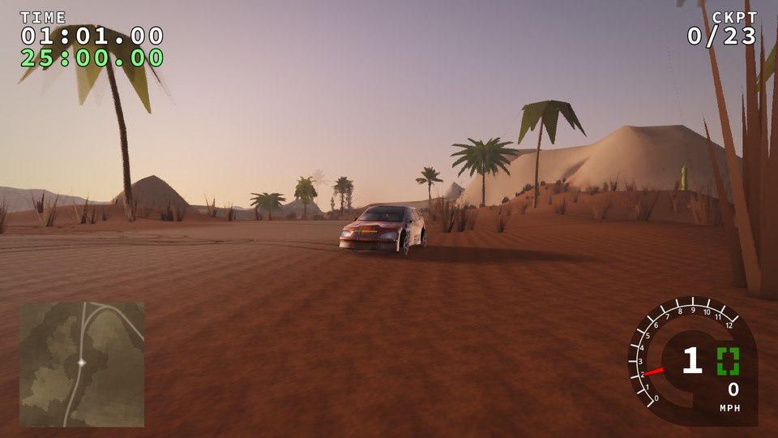
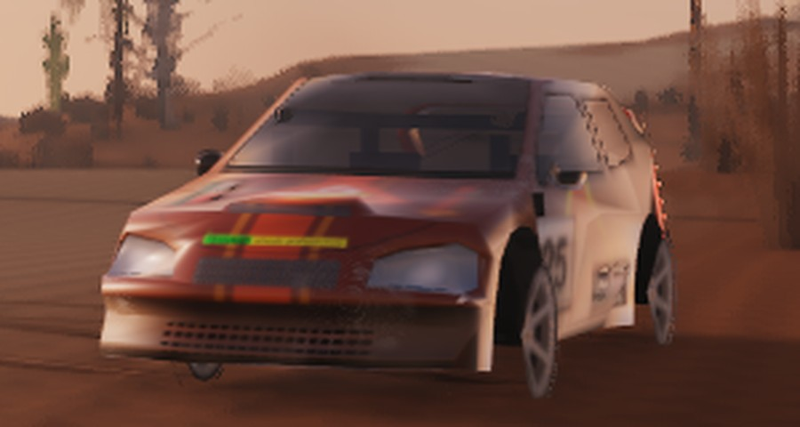
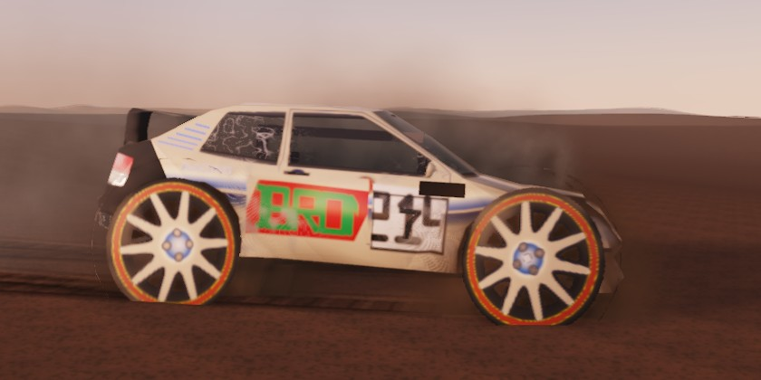
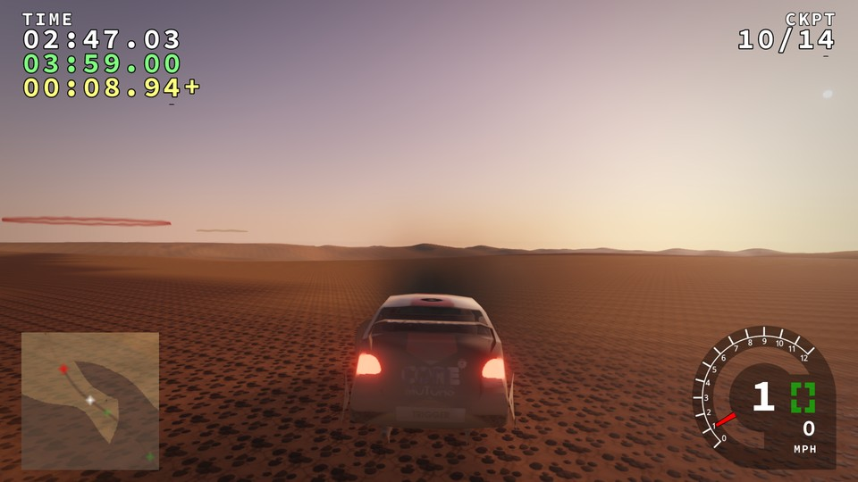
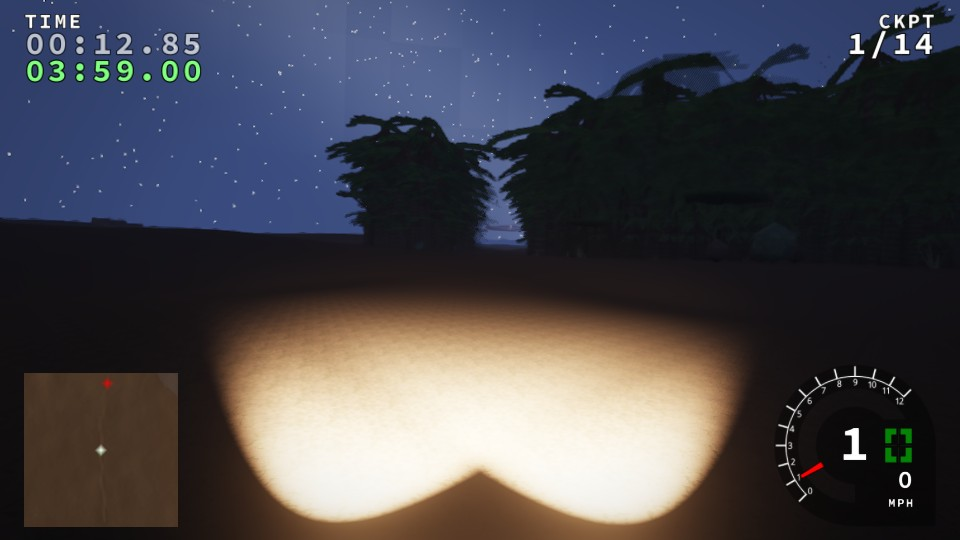
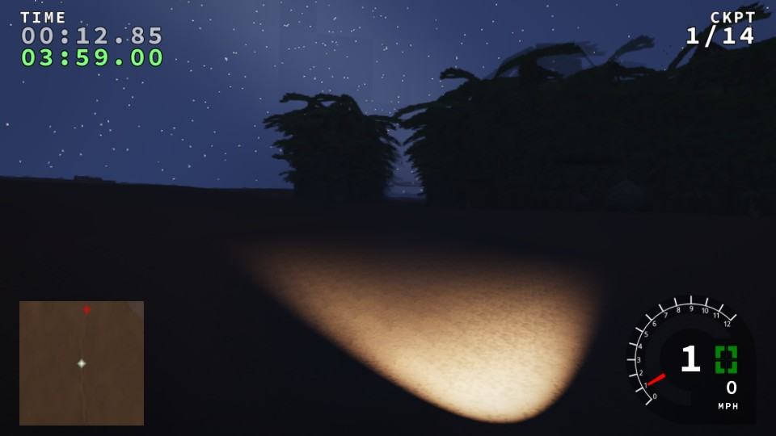
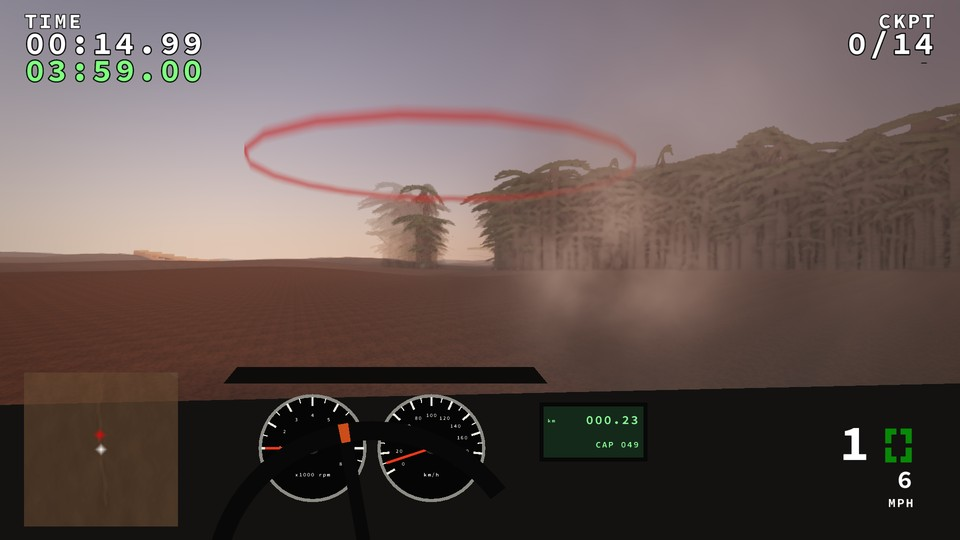

# Phase 4c: damage visuals (gate)

Master prompt Phase 4c: dents, decals, detachable parts, cracked glass and
smoke, **all driven by the existing damage model**. The amendment's order
(§A9) puts 4c after M2. PBR world only: the Legacy renderer and every state
hash are unchanged.

All images come from the harness on **software GL (llvmpipe)**, PBR medium.

## What the damage model gives

The existing `PDamage` keeps four corner values (front-left, front-right,
rear-left, rear-right). Contact impulses feed them at 1e-7 × force.
Measured with the new `tests/replays/crash_rollover.csv` (14 flat-out
flicks and handbrake rolls on `ahead`, 16 000 ticks), the corners reached
**0.094, 0.066, 0.028 and 0.009**, so real play never approaches 1. The
renderer therefore shows **visual severity = clamp(6 × simulation damage,
0, 1)** (`trackrs::car::VisualGain`). That session then reads 0.56, 0.39,
0.17 and 0.05. Physics keeps the raw values. **The gain is a proposal for
review:** it is the one tuning number in this phase.

## What shipped

| Item | Implementation |
|---|---|
| **Damage field** | `engine/car/damage_visual`: a smooth falloff from each corner, the strongest corner wins. Pure C++ with unit tests (`car-damage-visual`), mirrored in `car.vert` and `pbr.frag`. The renderer reads through a new side-effect-free `PDamage::level()`; `getDamage(side)` clears the HUD flash and is left alone. |
| **Dents** | `car.vert` pushes body vertices in along the normal, up to 8 % of the body width, creased by noise. `pbr.frag` blends faceted normals over dented panels. |
| **Detachable parts** | The borrowed fictional bodies have no separate part meshes, so the bumper end (outer 15 % of the length, lowest quarter) **sags** at the heaviest damage instead. Real detachable parts need segmented models (4d sourcing). |
| **Decals: scratches and scuffs** | Patches of gouges whose direction wanders. Primer first, then bare steel on the deepest scratches above 0.6. |
| **Dust and mud carry over** | Paint damage is applied **before** the 4b dust and mud, and dirt clings to the scratches (`carDirt = max(dirt, scratch × coverage × 0.8)`). |
| **Cracked glass** | A crack web on glass near corners above 0.3, with more opacity where it is crazed. |
| **Broken lamps** | A corner at 0.8 or more darkens its lamp texels (head or tail) **and removes its headlight beam** from the scene lights. |
| **Smoke** | A front above 0.55 smokes from under the bonnet. It is a second particle system, PBR world only, with **its own RNG stream**, so the dirt particles and Legacy output are unchanged. |
| **Harness** | `--damage-visual fl,fr,rl,rr` forces render-only severity. Car reports carry `damage_sim`, `damage_visual` and `damage_forced`. |

### M2 livery fixes found on the way

| Problem | Fix |
|---|---|
| The legacy lettering ("MOTORS") of the borrowed body still showed through the T1's fictional sponsor. | Two causes. First, the logo only blends, so sponsor slots now take an opaque `backing`. Second, the role map, classified from the original atlas, kept the white letters as metal or headlamp. The new `repaintRoles()` marks livery art as plain paint. |
| Mudflaps turned cream (a slot overlapped their UVs). | Livery art never paints glass, rubber or tail-lamp texels; they are restored from the pre-art atlas. |
| The T1's sponsor slot overlapped the race number. | Slot rects adjusted. |

Tests: `car_assets_tests` gains three cases (backing, role repainting, protected texels).

## Checks

| Check | Result |
|---|---|
| `ctest` | 28/28 (adds `car-damage-visual`; `car_assets_tests` +3 cases) |
| Legacy golden manifest (`run_baselines.py --compare`, all **13** stages) | **identical**: state hashes and framebuffers |
| Pack-lite runtime gate | PASS |
| Shader compile and link | PASS (16 permutations plus world) |
| clang-tidy on the changed engine files | `damage_visual.cpp`, `car_assets.cpp`, `car_renderer.cpp`: clean. `engine/renderer/renderer.cpp` has two findings from Phase 4b (lines 127, 236); that file is outside the production lint list. |
| Determinism | Damage is read only: the 13-stage golden comparison above shows simulation state unchanged. |

## Images

| | |
|---|---|
|  **Real damage** (no override): `cordo_wrc` after `crash_rollover.csv`, sim 0.094/0.066/0.028/0.009, visual 0.56/0.39/0.17/0.05 |  close-up: scuffed and dented front, faceted bonnet |
|  **Forced** 0.3/1.0/0.2/0.9: crazed rear side glass, scuffed rear quarter, dented front wing, engine smoke |  **Forced** 0.8/0.8/0.5/0.5 after the M2 gravel run: dust 1.0 and mud 0.23 over the damage |
|  night, hood camera, no damage: both beams |  **Forced** front-left 1.0: the left beam is gone |
|  **Forced** front 0.95/0.95, cockpit camera: smoke ahead of the car. The windscreen web does not show here, because the cockpit view does not draw the car body (see below). | |

## Not done in 4c

* **No 3D cockpit,** so no cracked windscreen from inside: the cockpit camera
  does not draw the car body (`renderowncar` is false, as for the hood and
  bumper cameras). Cracks show from outside.
* **No real detachable parts** (no segmented meshes). The sag is the stand-in.
* **No sparks, debris or deformation of the collision shape.** Physics is
  untouched, as the phase requires.
* **Smoke** uses the dirt sprite. There is no fire.
