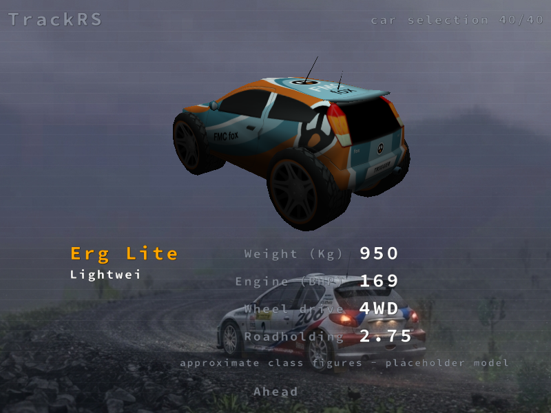
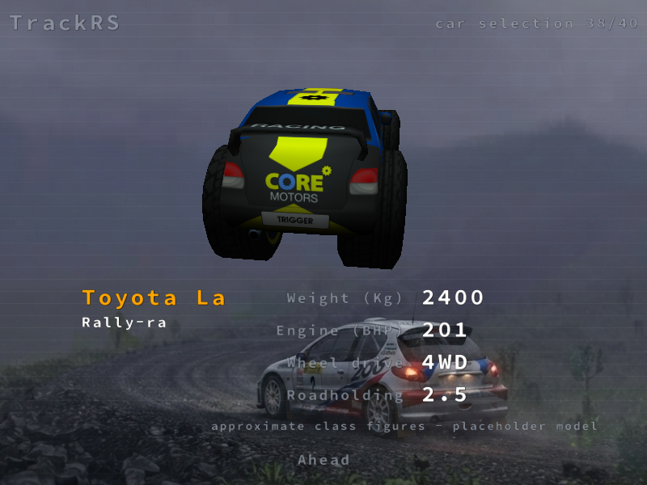

# Phase 4d: roster and asset sourcing (gate)

Master prompt Phase 4d, with the amendment's §A5 car priorities: rally-raid
first, then heritage raid, then the existing rally roster. **No car mesh was
supplied in this phase.** Every new car shows as "(placeholder model)" on a
borrowed fictional legacy body.

The maintainer accepted **class-typical figures with `verified: false`** for
the new packs. Electric and hybrid prototypes wait for Phase 6.

## What shipped

| Item | Where |
|---|---|
| **Mesh specification** for each class pack: axes, metres, part and material names (separate bumpers, mirrors, wheels, lamps), triangle budgets per LOD, texture sizes, accepted licences, trademarks, provenance | [ASSET_SOURCING.md](../ASSET_SOURCING.md) |
| **Mesh checker**: a stdlib `.glb` parser that enforces that page (parts, LODs, budgets, size, ground and centre, front −Z, wheel radius and hub origin, power-of-two textures) | `tools/check_car_mesh.py`, test `car-mesh-checker` (9 defect kinds) |
| **Class packs** `class-rally-raid` (9 cars) and `class-heritage-raid` (6 cars), each with a manifest, licence entries, trademark notices, provenance and fictional liveries | `data/packs/class-*`, generated by `tools/seed_class_packs.py` (test `car-class-packs-fresh`) |
| **Cited values, per value** (`data_overrides.json`): an optional file per car; every value needs an https `source`; a data group turns `verified: true` only when the file covers all of it | `tools/seed_class_packs.py`, test `car-data-overrides`, [CAR_DEFINITION.md](../CAR_DEFINITION.md) |
| **Car selection labels**: "approximate class figures" when any data group is unverified, "placeholder model" when no mesh is supplied | `src/Trigger/render.cpp` |
| **Power shown from `car.json`**: the "Engine (BHP)" line uses the Car v2 torque curve's peak power; legacy `.vehicle` cars keep the old formula | `src/PSim/vehicle.cpp` |
| **Pack cars** load in car selection and in the harness (`--vehicle pack:car`) | `loadVehicles`, `tools/car_render_report.py` |
| **Generated roster page**: all 39 cars, with class, model status, licence, verified groups, trademark notice and measured cost | [CARS.md](../CARS.md), `tools/gen_cars_md.py` (test `cars-md-fresh`) |
| ADRs: class-typical figures; roster kept in `data/vehicles`; checker before loader; `data_overrides.json`; the selection labels | [DECISIONS.md](../DECISIONS.md) |

## Car selection evidence

Real game, `full` edition data copy, software GL. Both cars carry both
labels; the power reads 169 and 201 BHP from their curves (before the fix,
the Land Cruiser 79 read 71 BHP from the legacy formula).

| Erg Lite T3 (`morocco-sahara`) | Toyota Land Cruiser 79 T2 (`class-rally-raid`) |
|---|---|
|  |  |

**Edition policy.** The shipped `data/policy/edition.json` is the `demo`
edition, which loads only `morocco-sahara`. The class packs therefore appear
in `full` and `dev` builds only. These captures use a copy of the data with
the `dev` policy. I did not change the shipped policy; that is the
maintainer's call.

## §A5 cars: in a pack or left out

| §A5 | Car named in the amendment | Status | Car id / reason |
|---|---|---|---|
| 1 | Toyota Hilux T1+ | **in** | `class-rally-raid:toyota_gr_dkr_hilux_t1plus` |
| 1 | Ford Ranger Raptor T1+ | **in** | `class-rally-raid:ford_ranger_raptor_t1plus` (renamed from `ford_raptor_t1plus`) |
| 1 | Mini John Cooper Works Rally | **in** | `class-rally-raid:mini_jcw_rally_t1plus` |
| 1 | Peugeot 3008 DKR Maxi | **in** | `class-rally-raid:peugeot_3008_dkr_maxi` (two-wheel drive) |
| 1 | Audi RS Q e-tron hybrid | **left out** | Electric/hybrid powertrain: Car v2 and the physics describe combustion engines only. Waits for Phase 6, as the maintainer decided. |
| 1 | Dacia Sandrider | **in** | `class-rally-raid:dacia_sandrider_t1plus` |
| 1 | Toyota Land Cruiser 79 (T1/T2 production) | **in** | `class-rally-raid:toyota_land_cruiser_79_t2` |
| 1 | Nissan Patrol (T1/T2 production) | **in** | `class-rally-raid:nissan_patrol_t2` |
| 1 | T3 lightweight prototypes (a class, no model named) | **in** | fictional `morocco-sahara:erg_lite_t3` |
| 1 | T4 side-by-side vehicles (optional) | **in** | `class-rally-raid:canam_maverick_xrs_t4` |
| 2 | Peugeot 205 T16 Grand Raid | **in** | `class-heritage-raid:peugeot_205_t16_gr_1987` |
| 2 | Peugeot 405 T16 GR | **in** | `class-heritage-raid:peugeot_405_t16_gr_1988` |
| 2 | Citroën ZX Rallye Raid | **in** | `class-heritage-raid:citroen_zx_rallye_raid_1991` |
| 2 | Mitsubishi Pajero | **in** | `class-heritage-raid:mitsubishi_pajero_evolution_1998` |
| 2 | Porsche 959 Paris-Dakar | **in, renamed** | `class-heritage-raid:porsche_959_raid_1986`, shown as "Porsche 959 (rally-raid, 1986)": the amendment forbids the word "Dakar" and real event names. |
| 3 | Existing rally roster (classics, Group B, Group A, WRC) | **in, kept in place** | `data/vehicles`: 11 real-car entries from 4a and 11 fictional legacy cars. Not moved into a pack, because their paths are part of the golden hashes, the calibration tests and saved profiles (ADR). |

Beyond the named list:

* **Also added:** `class-heritage-raid:range_rover_classic_raid_1981`.
* `class-rally-raid:prodrive_hunter_t1plus` (T1+) and the fictional
  `morocco-sahara:draa_raid_t1` are also in.
* **§A5.4** (fictional Moroccan teams, zellige-style decals) and **§A5.5**
  (raid physics as data) are not part of this gate. They are in the
  [PROGRESS](../PROGRESS.md) backlog.
* **§A5.6** (trucks) is out of scope for 0.7 and is recorded in the backlog.

## Per-car GPU time and VRAM

`tools/car_render_report.py`, software GL (**llvmpipe**), 640×480, PBR
medium, CSM shadows, noon, stage `ahead`, 24 frames per car. The raw data is
in [phase4d/cars.json](phase4d/cars.json).

* **VRAM** is the renderer's own accounting for the car type (meshes plus
  textures).
* **CPU ms** is the wall time of the `cars` and `shadow_cars` passes per
  frame. Under software GL it includes rasterisation queueing.
* **GPU ms** is the GL timer query. llvmpipe reports almost nothing for it,
  so it carries no information here.
* **Hardware numbers are still owed** by the maintainer.

Summary: every car costs **13.38–13.53 MB**, almost all of it the borrowed
body's 13.33 MB of textures. The 17 pack cars draw 2 036 or 2 156 triangles at LOD0, depending on the borrowed body.
Median CPU per frame: **0.60 ms** (`cars`) and **0.62 ms** (shadows).

GOLDEN_REMEASURE_PLACEHOLDER

| id | car | VRAM MB | of which textures MB | triangles drawn | CPU ms cars | CPU ms shadows | GPU µs (llvmpipe) |
|---|---|---|---|---|---|---|---|
| `alpine_a110_1800` | Alpine A110 1800 (placeholder model) | 13.38 | 13.33 | 2036 | 29.05 | 0.69 | 0.07 |
| `audi_quattro_a2` | Audi Quattro A2 (placeholder model) | 13.53 | 13.33 | 8772 | 23.03 | 1.32 | 0.05 |
| `bmw_m3_e30_group_a` | BMW M3 E30 Group A (placeholder model) | 13.38 | 13.33 | 2036 | 0.51 | 0.56 | 0.05 |
| `class-heritage-raid:citroen_zx_rallye_raid_1991` | Citroen ZX Rallye-Raid (placeholder model) | 13.38 | 13.33 | 2156 | 0.64 | 0.65 | 0.08 |
| `class-heritage-raid:mitsubishi_pajero_evolution_1998` | Mitsubishi Pajero Evolution (raid, 1998) (placeholder model) | 13.38 | 13.33 | 2156 | 0.60 | 0.75 | 0.11 |
| `class-heritage-raid:peugeot_205_t16_gr_1987` | Peugeot 205 T16 Grand Raid (placeholder model) | 13.38 | 13.33 | 2156 | 0.64 | 0.61 | 0.06 |
| `class-heritage-raid:peugeot_405_t16_gr_1988` | Peugeot 405 T16 Grand Raid (placeholder model) | 13.38 | 13.33 | 2156 | 0.62 | 0.69 | 0.09 |
| `class-heritage-raid:porsche_959_raid_1986` | Porsche 959 (rally-raid, 1986) (placeholder model) | 13.38 | 13.33 | 2156 | 0.59 | 0.67 | 0.10 |
| `class-heritage-raid:range_rover_classic_raid_1981` | Range Rover (raid, 1981) (placeholder model) | 13.38 | 13.33 | 2156 | 0.66 | 0.60 | 0.05 |
| `class-rally-raid:canam_maverick_xrs_t4` | Can-Am Maverick XRS (T4) (placeholder model) | 13.38 | 13.33 | 2036 | 0.91 | 0.65 | 0.07 |
| `class-rally-raid:dacia_sandrider_t1plus` | Dacia Sandrider (placeholder model) | 13.38 | 13.33 | 2156 | 0.57 | 0.62 | 0.05 |
| `class-rally-raid:ford_ranger_raptor_t1plus` | Ford Ranger Raptor T1+ (placeholder model) | 13.38 | 13.33 | 2156 | 0.57 | 0.62 | 0.06 |
| `class-rally-raid:mini_jcw_rally_t1plus` | Mini John Cooper Works Rally (placeholder model) | 13.38 | 13.33 | 2156 | 0.56 | 0.61 | 0.06 |
| `class-rally-raid:nissan_patrol_t2` | Nissan Patrol (T2) (placeholder model) | 13.38 | 13.33 | 2156 | 0.57 | 0.62 | 0.07 |
| `class-rally-raid:peugeot_3008_dkr_maxi` | Peugeot 3008 DKR Maxi (placeholder model) | 13.38 | 13.33 | 2156 | 0.58 | 0.62 | 0.05 |
| `class-rally-raid:prodrive_hunter_t1plus` | Prodrive Hunter T1+ (placeholder model) | 13.38 | 13.33 | 2156 | 0.64 | 0.66 | 0.06 |
| `class-rally-raid:toyota_gr_dkr_hilux_t1plus` | Toyota GR DKR Hilux T1+ (placeholder model) | 13.38 | 13.33 | 2156 | 0.58 | 0.59 | 0.07 |
| `class-rally-raid:toyota_land_cruiser_79_t2` | Toyota Land Cruiser 79 (T2) (placeholder model) | 13.38 | 13.33 | 2156 | 0.59 | 0.58 | 0.07 |
| `cordo_kitcar` | Cordo | 13.38 | 13.33 | 2156 | 0.60 | 0.55 | 0.06 |
| `cordo_super500` | Cordo | 13.38 | 13.33 | 2156 | 0.57 | 0.56 | 0.06 |
| `cordo_wrc` | Cordo | 13.38 | 13.33 | 2156 | 0.52 | 0.56 | 0.06 |
| `evo_kitcar` | Zaibatsu | 13.38 | 13.33 | 2000 | 0.68 | 0.60 | 0.06 |
| `evo_rally` | Evo Rally | 13.53 | 13.33 | 8772 | 1.39 | 1.41 | 0.05 |
| `evo_super500` | Zaibatsu | 13.38 | 13.33 | 2000 | 0.62 | 0.63 | 0.05 |
| `evo_wrc` | Zaibatsu | 13.38 | 13.33 | 2000 | 0.54 | 0.59 | 0.06 |
| `ford_escort_rs_cosworth` | Ford Escort RS Cosworth (placeholder model) | 13.53 | 13.33 | 8772 | 1.32 | 1.28 | 0.08 |
| `fox_kitcar` | Fox | 13.38 | 13.33 | 2036 | 0.55 | 0.59 | 0.06 |
| `fox_super500` | Fox | 13.38 | 13.33 | 2036 | 0.56 | 0.61 | 0.07 |
| `fox_wrc` | Fox | 13.38 | 13.33 | 2036 | 0.55 | 0.60 | 0.08 |
| `lancer_evo` | Lancer Evo | 13.50 | 13.33 | 8548 | 1.40 | 1.41 | 0.05 |
| `lancia_delta_hf_integrale` | Lancia Delta HF Integrale (placeholder model) | 13.53 | 13.33 | 8772 | 1.38 | 1.27 | 0.05 |
| `lancia_stratos_hf` | Lancia Stratos HF (placeholder model) | 13.38 | 13.33 | 2036 | 0.54 | 0.58 | 0.07 |
| `morocco-sahara:draa_raid_t1` | Draa Raid T1 (placeholder model) | 13.38 | 13.33 | 2156 | 0.57 | 0.65 | 0.06 |
| `morocco-sahara:erg_lite_t3` | Erg Lite T3 (placeholder model) | 13.38 | 13.33 | 2036 | 0.61 | 0.70 | 0.08 |
| `peugeot_205_t16_e2` | Peugeot 205 T16 E2 (placeholder model) | 13.53 | 13.33 | 8772 | 1.40 | 1.29 | 0.06 |
| `peugeot_206_wrc` | Peugeot 206 WRC (placeholder model) | 13.53 | 13.33 | 8772 | 1.37 | 1.26 | 0.06 |
| `porsche_911_sc_rs` | Porsche 911 SC RS (placeholder model) | 13.38 | 13.33 | 2036 | 0.53 | 0.60 | 0.06 |
| `subaru_impreza_wrc97` | Subaru Impreza WRC97 (placeholder model) | 13.53 | 13.33 | 8772 | 1.38 | 1.22 | 0.06 |
| `toyota_celica_gt4_st185` | Toyota Celica GT-Four ST185 (placeholder model) | 13.53 | 13.33 | 8772 | 1.41 | 1.33 | 0.06 |
