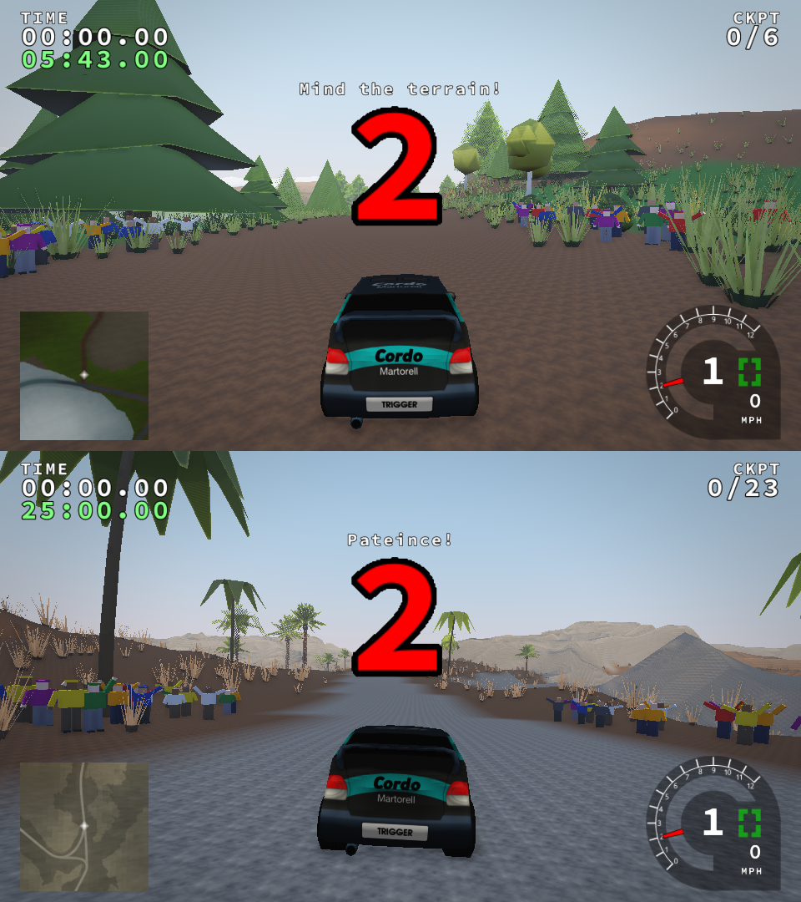

# Phase 5a (early slice) — spectators, TV camera operators and news crew

Requested ahead of Phase 4. This covers the people part of the §5 "rally
atmosphere" pass only. Signage, barriers, tape, marshals and the road ribbon
remain in Phase 5 (see [PROGRESS](../PROGRESS.md)). PBR only; Legacy is
unchanged.

## Where people stand, and why

`engine/dressing/people.cpp` places everyone deterministically, seeded by the
stage file name, when a stage loads:

1. **Real road centreline.** Mandatory checkpoints are sparse (glacier has 6),
   so straight lines between them cut across corners by tens of metres. The
   placer keeps every checkpoint, pace-note ones included, in driving order. It
   then traces the roadmap corridor leg by leg:
   * 4 m steps, steering to stay inside the corridor;
   * re-centring across it at every step;
   * a length budget per leg, with a straight-chord fallback so one bad
     junction never discards the stage.

   Results: glacier 36/36 legs followed, ahead 131/133, coastline 40/43,
   mud 14/14.
2. **Safety rule.** Nobody stands within (assumed road half-width 5 m +
   margin) of the centreline of *any* part of the route, which also covers the
   other leg of a hairpin. Margins are 6 m for spectators, 9 m for TV camera
   operators and 10 m for the news crew. People are also kept off slopes
   steeper than 0.45 and out of water, with 0.9 m of personal space between
   them. The roadmap marks the wide no-penalty corridor (often 50–150 m), not
   the driven surface, so the road width is an explicit, documented assumption.
3. **Logical spots:**
   * crowds stand on both sides of the start and finish;
   * at the tightest bends, crowds stand on the **inside** of the corner,
     because the outside of a bend is the run-off and danger zone;
   * the four tightest corners each get a **TV camera operator with a tripod
     camera**, placed just before the apex;
   * the **news reporter** stands beside or behind the start line, facing a
     camera operator positioned further from the road, so the stage is the
     backdrop.

   Spectators face the road.
4. **Behaviour (per frame, visual only):**
   * spectators step up to 1.4 m *away* from the road as a car comes within
     30 m;
   * they turn towards the car, and the cheering ones wave and jump as it
     approaches;
   * TV cameras and their operators pan with the nearest car within 160 m;
   * the reporter keeps talking to camera.

## Rendering

Original procedural figures are built from boxes:
* jacket, trousers and skin palettes;
* caps, shoes, hands;
* a shoulder-mounted broadcast camera, a microphone, and a tripod camera.

Each has 3 LODs (spectator 96 / 60 / 36 triangles). Arm animation and palettes
live in `people.vert`, and shading goes through the shared PBR fragment path
(sun, sky IBL, CSM, fog, LOD dither). Drawing is one instanced call per
(kind, LOD). People cast CSM shadows within 120 m at LOD ≥ 1 and are skipped in
reflection probes. Setting: **Options → Spectators (PBR)**, `graphics.crowd`,
`--crowd on|off`.

## Verification

* `dressing-people`, five doctest cases on a synthetic stage (hairpin, lake,
  cliff):
  * everyone respects the clearance (including the hairpin's other leg), stays
    off the road, out of the water and off the cliff, and spectators face the
    road;
  * there is exactly one reporter near the start, plus TV crews and tripods;
  * personal space holds, and placement is deterministic per seed;
  * density scales the crowd;
  * step-back is directed away from the road, cameras track the car and fall
    back to the apex;
  * meshes are valid with outward CCW faces, and LODs get cheaper;
  * the tracer stays within 3 m of the true road through a hairpin, and its
    fallback ends at the last checkpoint.
* `run_world.py`: a crowd-off control and dressing-report assertions. All ten
  cases share physics hash `72d1a3ffd170d57c`
  ([world-crowd.json](phase5a/world-crowd.json)).
* Legacy A/B (ahead, glacier, coastline): identical state and framebuffer
  hashes. The terrain and PBR integration runners, the shader permutations,
  the layering check and the production clang-tidy set all pass.

Glacier: 383 people (377 spectators, 3 camera operators, 2 tripods,
1 reporter). Mesh 47 KB; instance stream about 16 KB.

## Known gaps

* There is no free camera yet (Phase 7), so automated captures only show the
  start crowds. The crews are proven by tests and per-stage counts rather than
  screenshots.
* The figures are blocky low-poly. Skeletal or vertex-animation-texture people,
  flags, umbrellas, tents and night torches remain Phase 5 items, as do crowd
  audio and marshals.
