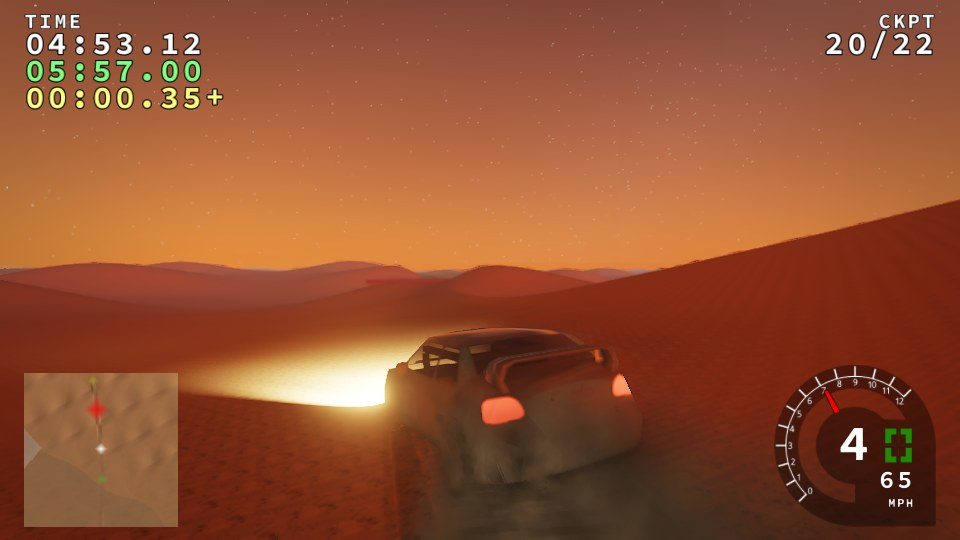
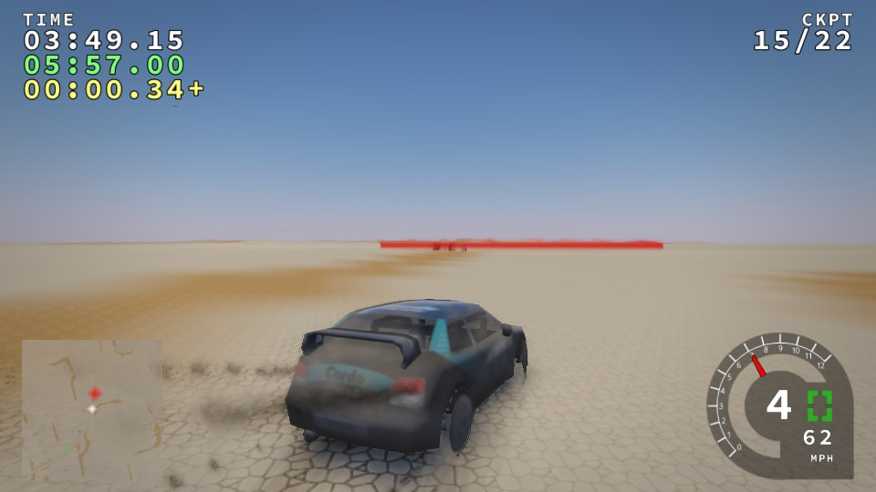
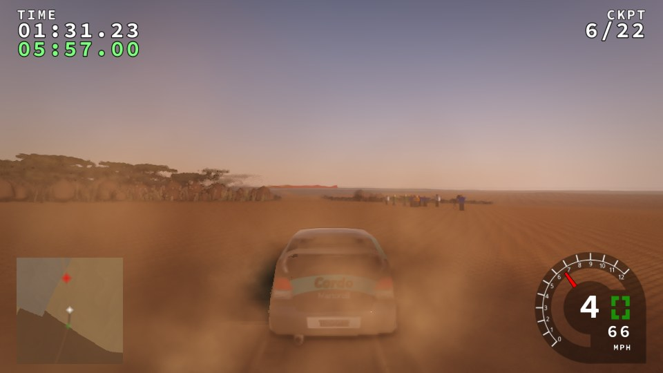
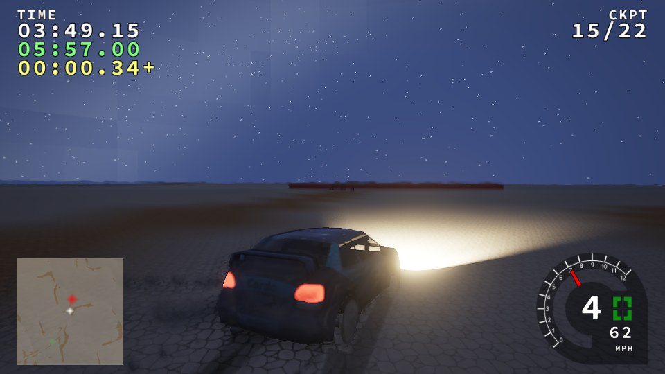
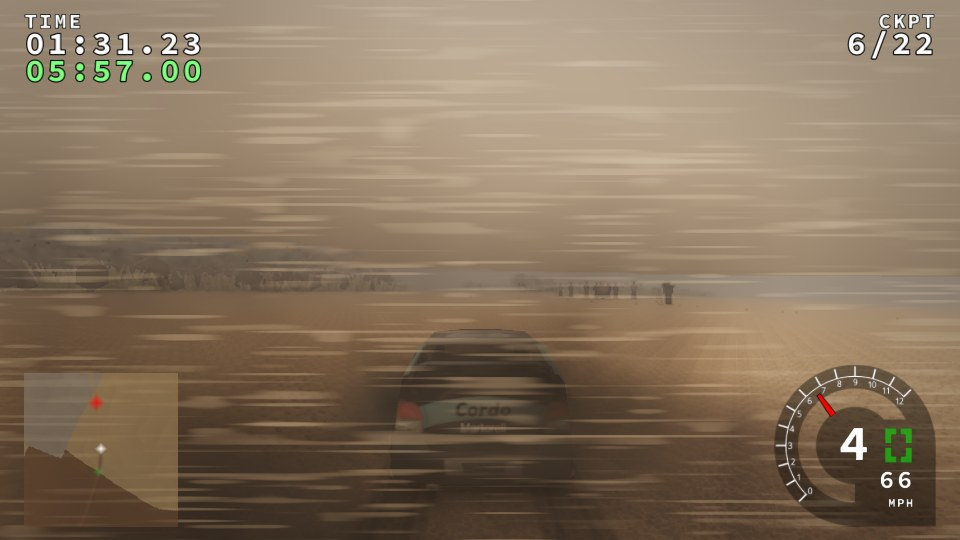
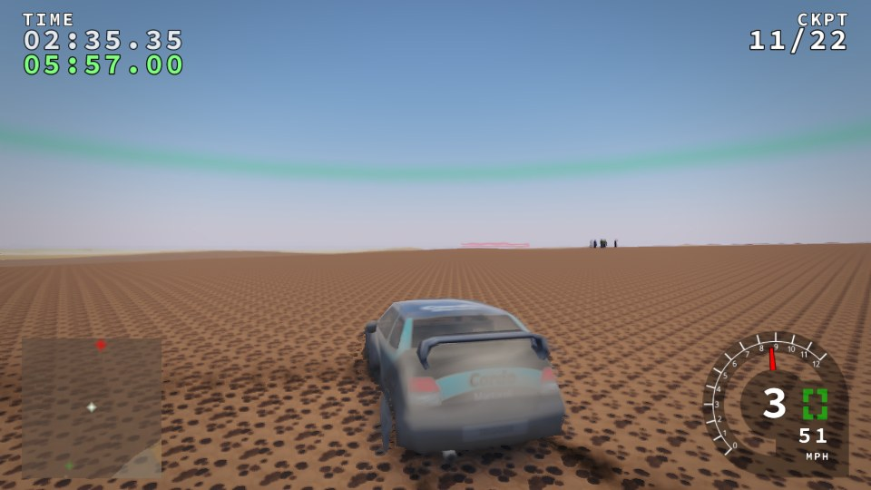
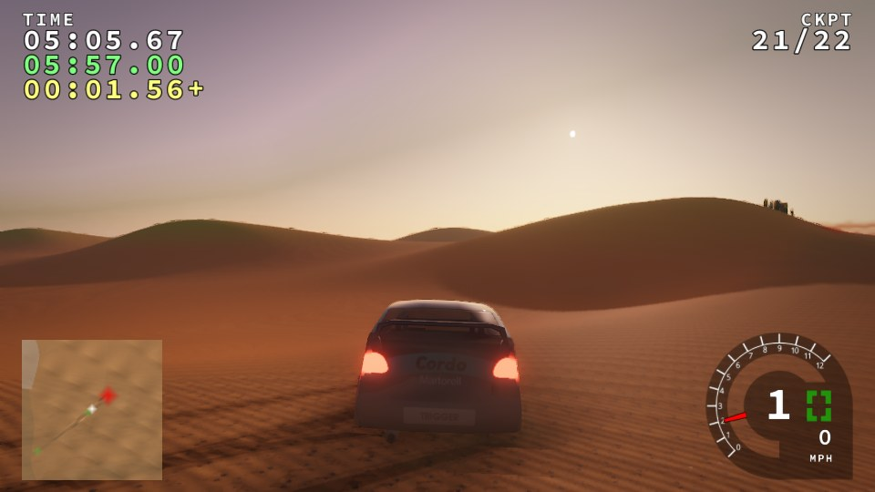
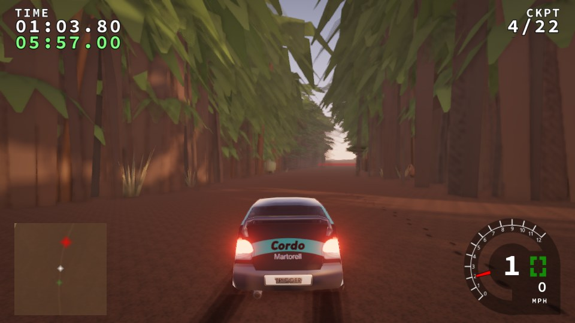
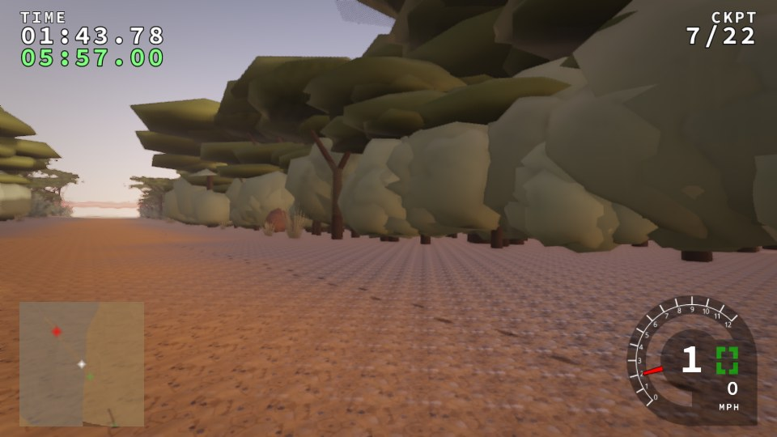
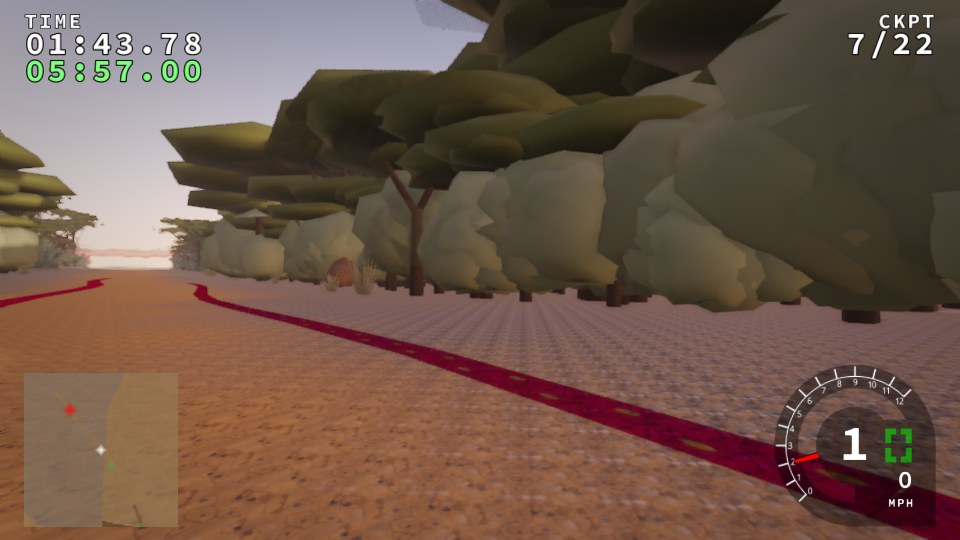

# M1: Saharan world tech (gate)

Amendment §A9.3: the A3 items 1–6 on one test stage,
`morocco-sahara:sahara-lab`. It is `test_only`,
`"geographic_fidelity": "procedural"` and represents no real place. All
images are from the harness on **software GL (llvmpipe)**: PBR renderer,
medium quality, 960×540, the default car `cordo_kitcar` on `--autopilot 100`.
GPU timings are therefore **software timings**, flagged as such; they are not
budgets.

## A3 coverage

| A3 item | What shipped | Evidence |
|---|---|---|
| **1. Desert PBR materials** | Nine CC0 sets (`sand_dune`, `fesh_fesh`, `hard_sand`, `hamada_stone`, `oued_gravel`, `dry_lake_clay`, `palmeraie_dirt`, `rock`, `tarmac_n9`) baked by `tools/bake_desert_materials.py` with per-set provenance. Nine new `TerrainType`s, with physics copied from their nearest legacy class (no legacy map uses the new colours). Terrain shader: 0.16 m wind-ripple normals with derivative fade, slip-face darkening on steep lee slopes, view-dependent grain glints, wetness off. | `noon-lake.jpg`, `hamada-noon.jpg`, `dawn-dunes.jpg` |
| **2. Dune generator** | `tools/stage_from_heightmap.py`: barchan, linear and star presets across the wind (78 % stoss, 22 % slip face), warped zone masks, smooth CDLOD normals. **No interactive editor:** dune fields are authored in the JSON spec. | `dawn-dunes.jpg` |
| **3. Persistent tracks** | New (TrackRS had no rut system to reuse; see ADR). `engine/terrain/tracks`: a 32768-segment ring fed once per tick from each wheel contact, surface-dependent rut depth, lip and darkening. Static camel and foot trails come from `props.json`. `tracks_renderer` draws ground ribbons whose fragment shader rebuilds the relief and multiplies the lit ground. Visual only, never read by physics. | `ruts-dune.jpg`, `ruts-palmeraie.jpg`, `prints-hood.jpg`, `prints-debug.jpg` |
| **4. Atmosphere** | Heat haze and mirage on flats (post, depth- and heat-scaled). Dry-air sky with turbidity from heat and dust, low-sun warm scatter, a Milky Way band and denser stars. `chergui` weather: orange grade, visibility, wind-driven streaks, dust that settles slowly and drifts with the wind. Climate comes from the level (`<weather wind winddegrees heat dust>`). | `night-stars.jpg`, `chergui.jpg`, `golden-ksar.jpg` |
| **5. Vegetation and props** | Pack species (date palm ×3 with dead-frond skirts, tamarisk, acacia, alfa grass, dead brush) as instanced 3D meshes with card impostors. Fifteen original prop kinds: camel and goat herds with vertex walk and graze animation, khaima, well, cairn, ksar kit (walls, crenellated towers, gate, geometric relief band), mud and concrete houses, water tower, power poles, seguia, start arch, sign board. Seeded placement keeps props off the road and off steep slopes. | `golden-ksar.jpg`, `ruts-palmeraie.jpg` |
| **6. Sun and shadow** | **CSM bug fixed:** the shadow pass inherited the scene's `glDepthRange(0, .999)`, so every terrain receiver read as occluded on every stage (legacy stages in PBR too). It now owns its depth range (ADR). Desert climates stretch the cascades ×1.6 for long views. Auto-exposure is the Phase 3d adaptive histogram and was not retuned: noon lake and hamada frames are no longer crushed now the shadows are right. Car glass and paint specular are the 4b car renderer's. | `noon-lake.jpg`; the before/after is described in the ADR |

## Checks (A10)

| Check | Result |
|---|---|
| Legacy content and hashes | All **13 legacy stages identical** to `tests/baselines/linux-gcc/manifest.json`: state hashes and framebuffers, `run_baselines.py --repeats 1 --compare`, with the pack mounted. Legacy-renderer output is untouched by every M1 change. |
| Content packs (`tests/run_packs.py`) | PASS: the shipped data validates, credits are current, broken fixtures are disabled with a reason, `fixture-good:mini` is deterministic (`9b1968f891e231fd`; the fixture was regenerated for the north-up fix), and a legacy stage gives the same hash with packs mounted (`3eebeb4e28341a5d`) |
| `ctest` | 27/27 pass (adds `terrain-tracks`: 5 cases, 141 assertions) |
| Production clang-tidy (adds `props`, `tracks`) | pass |
| Shader compile and link (`check_pbr_shaders.py`) | pass (adds `world/tracks`) |
| Generated assets fresh | `bake_sahara_sprites.py --check`, `bake_sahara_signs.py --check`: PASS (local only; CI has no Pillow or raqm) |
| Determinism: two identical `sahara-lab` runs (6000 ticks) | Identical: state `cb2912df7afbac2d`, dressing hash `13504518457582598160` (380 props), tracks hash `6e489dc7c6c402d7` |
| Times of day | dawn, noon, golden hour and night captured (`stage.json` lists all four) |
| No props on the road | 380 of 390 requested props placed; **10 rejected as too near the road**, 0 too steep. Animals graze and walk but are re-posed on the terrain, never onto the road texels used for placement. |
| Licence audit | `trackrs-content validate data`: PASS. Every pack file is covered, `credits-fresh` passes, and `docs/CREDITS.md` is regenerated. |
| Cultural review | [CULTURAL_M1.md](../reviews/CULTURAL_M1.md), **`reviewed: false`** until the maintainer confirms |
| Localisation | No user-visible text added in M1 (sign boards are blank on `sahara-lab`). Bilingual signage starts in M2. |

### Budgets (software GL; flagged, not budgets)

llvmpipe on a 4-core container; these are software timings, not budgets. GPU columns are timer queries; the tracks pass reads 0.00 because its two draws fall below the timer resolution (CPU cost about 1.8 ms per frame, mostly the first upload).

| View | frame ms avg | p99 | terrain GPU ms | CSM GPU ms | post GPU ms | tracks GPU ms | draws | triangles | RAM peak |
|---|---|---|---|---|---|---|---|---|---|
| `dawn-dunes` | 487 | 648 | 350 | 65 | 62 | 0.00 | 485 | 0.94 M | 1012 MiB |
| `noon-lake` | 425 | 495 | 266 | 75 | 73 | 0.00 | 433 | 0.76 M | 763 MiB |
| `golden-ksar` | 510 | 692 | 303 | 135 | 61 | 0.00 | 545 | 1.01 M | 947 MiB |
| `night-stars` | 386 | 476 | 275 | 26 | 74 | 0.00 | 449 | 0.80 M | 977 MiB |
| `chergui` | 474 | 705 | 308 | 95 | 61 | 0.00 | 454 | 0.83 M | 833 MiB |
| `hamada-noon` | 376 | 527 | 220 | 72 | 72 | 0.00 | 409 | 0.74 M | 832 MiB |

The tracks ring is 2.3 MB of CPU memory and about 6 MB of vertex and index buffers.

## Images

All from `docs/reports/phaseM1/` (JPEG q88).

| | |
|---|---|
|  dawn, dune field (slip faces, warm scatter) |  noon, cracked dry lake (CSM fixed) |
|  golden hour, ksar and acacias |  night, stars and Milky Way |
|  chergui |  hamada at noon (the green ring is the legacy next-checkpoint marker) |
|  tyre ruts after a stop in the dunes |  ruts in palmeraie dirt |
|  camel and foot trails beside the piste (hood camera) |  the same trail in debug colours: print relief in green |

## Known limits (not done in M1)

* **Rut depth testing:** ribbons are pulled toward the eye in proportion to
  range, so they survive CDLOD's coarser far grids. Behind a nearby crest
  they can show through by a few decimetres. The exact fix is a
  depth-projected screen-space decal.
* **Prints at grazing angles:** camel and foot prints read at low sun and
  close range, and fade into texture noise when seen edge-on from far away
  (as in reality).
* **No rut physics:** wheels do not follow earlier ruts.
* **No dune editor UI:** dune fields are authored in the stage spec.
* **No sand particles in chergui:** the effect is screen-space streaks plus
  wind-carried car dust.
* **Exposure** was checked by eye on the noon frames, with no new metering
  mode.
