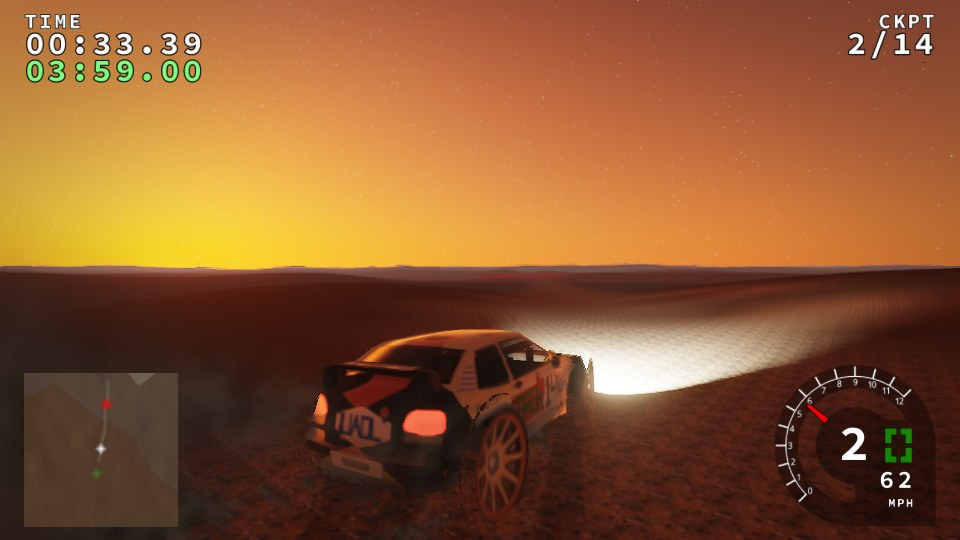
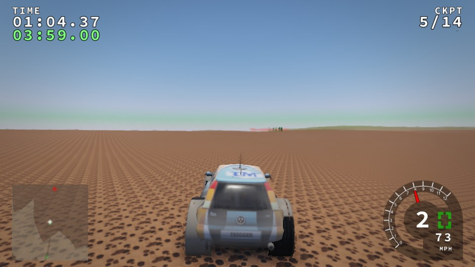
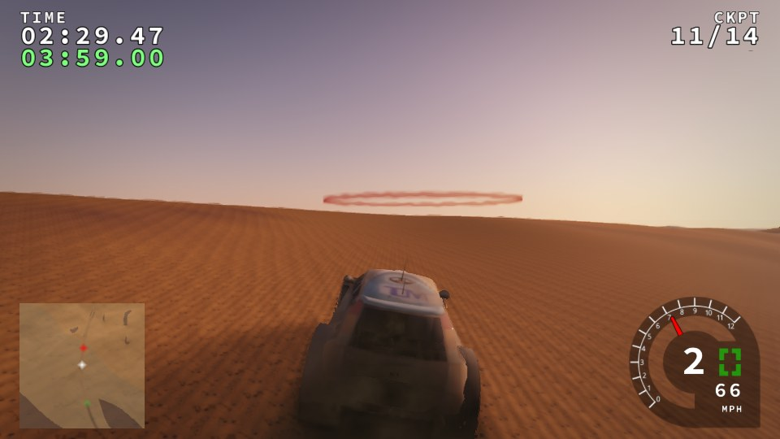
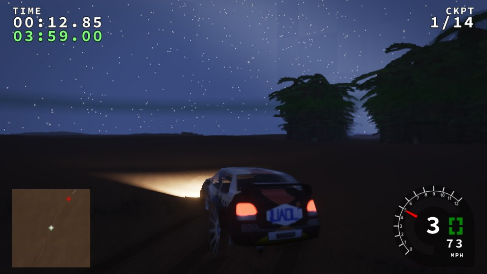
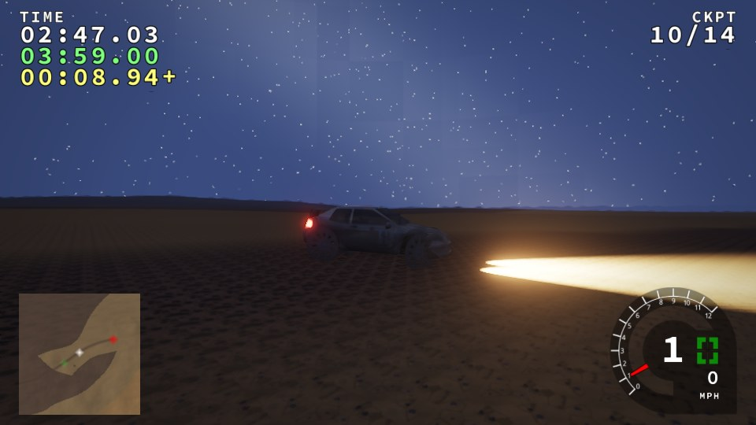
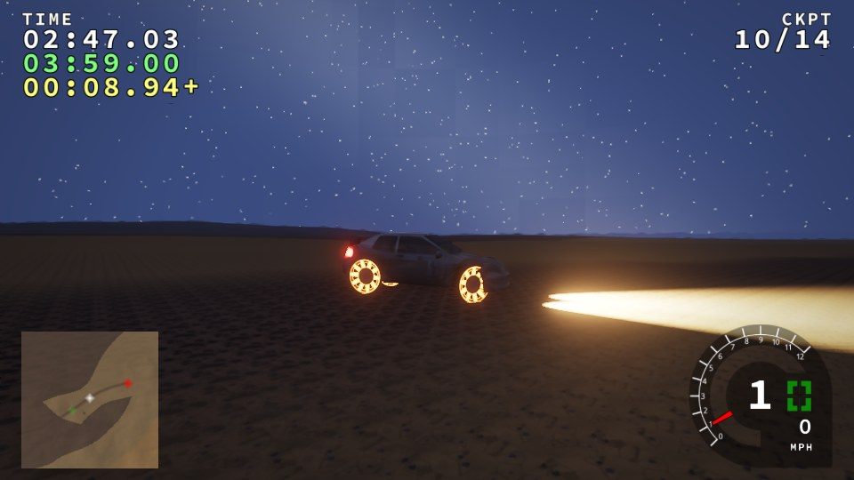
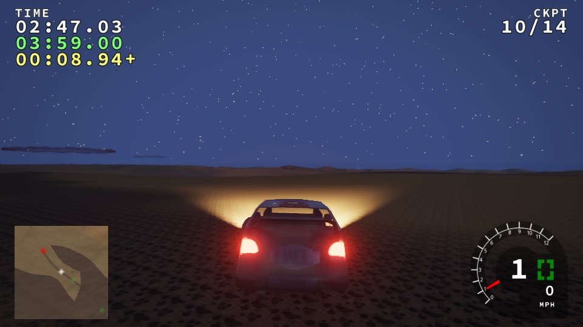
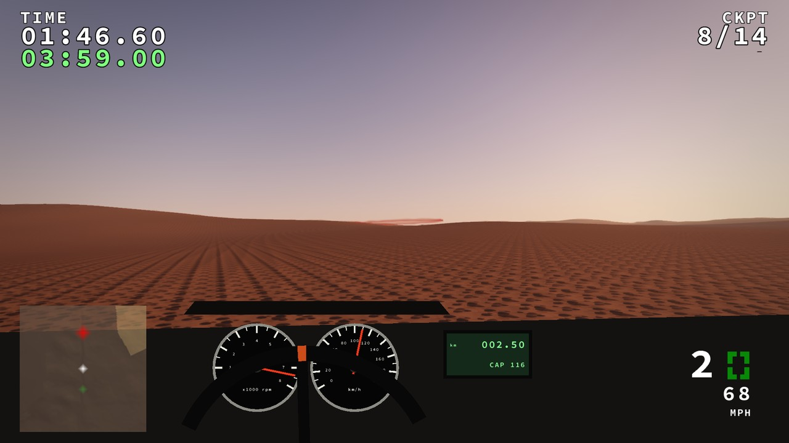
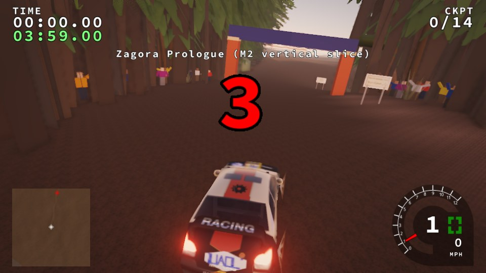
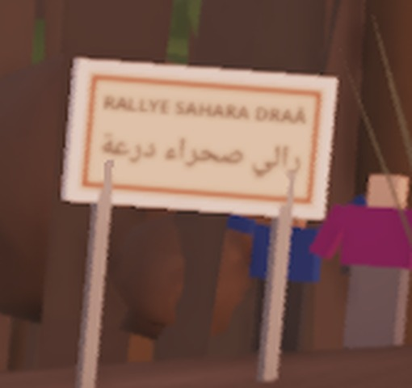

# M2: Zagora Prologue vertical slice (gate)

Amendment §A9.4: one playable stage near Zagora on real terrain, with two
rally-raid cars. Stage `morocco-sahara:zagora-prologue`, 4.31 km, 14
checkpoints, `"geographic_fidelity": "derived"`. Cars
`morocco-sahara:draa_raid_t1` and `morocco-sahara:erg_lite_t3`.

All images come from the harness on **software GL (llvmpipe)**: PBR renderer,
medium quality, 960×540, `--autopilot 110`. Timings are software timings,
flagged; they are not budgets.

## What the gate asked for

| Gate item | Result | Evidence |
|---|---|---|
| Sunrise, noon, golden-hour and night screenshots | Done, with both cars across the four times | `sunrise.jpg`, `noon.jpg`, `golden-hour.jpg`, `night.jpg` |
| Night capture of **brake-disc glow** after a long gravel run with hard braking, with visible dust and mud build-up | **Accepted by the maintainer, with the forced capture counted as proof of the rendering** (normal-run glow is an M5 backlog item: the Lake Iriki braking zone). The real run (2.1 km of hamada gravel, then 8 hard-braking cycles from 70 to 30 km/h and a full stop) builds dust 1.0 and mud 0.23, but the discs peak at **164 °C**, below the 4b model's glow threshold of 350 °C, so they do not glow. A second, labelled capture forces 700 °C (`--brake-heat`, reported as `brake_forced`) to show the glow rendering itself works. | `brake-measured.jpg`, `brake-chase.jpg`, `brake-forced.jpg` |
| Cockpit-camera capture showing the gauges | Done. New `cockpit` camera with a **placeholder** screen-space dashboard: tachometer, speedometer, steering-wheel rim and rally-raid tripmaster (distance and CAP heading). There is no 3D interior. | `cockpit.jpg` |
| Hash checks | Legacy golden manifest identical on the three CI stages (ahead, aegyptian, greenland: state and framebuffer). Legacy reference benchmark reproduces the Phase 2a state hashes (`bed7bcb42097dea3`, `1e68b34e874cedea`, `db012aa29e458299`). Zagora determinism: two identical T1 runs give the same state, dressing and tracks hashes. | |
| Benchmark | {{BENCH}} | |
| Licence checks | `trackrs-content validate data`: PASS (2 stages, 36 files covered); `docs/CREDITS.md` current; desert terrain provenance PASS; sign atlas fresh. The SRTM stage asset is listed `verified:false` until you confirm the source terms. | |

### Why the discs do not glow in the real run

A 1950 kg car stopping from 70 km/h puts about 370 kJ into its brakes, about
214 kJ of it into the front pair. Two cast-iron discs of about 8 kg each
(c ≈ 450 J/kg·K) rise only about 30 K per stop. The 4b heat model is already
stronger than that, and it still settles near 164 °C, because the T1's
legacy physics tops out near 80 km/h on gravel. Real discs glow after
repeated braking from much higher speeds or on long descents. M2 does not
fake this: the glow is shown only in the forced, labelled capture. The
maintainer accepted M2 with that capture counted as proof of the rendering.
A high-speed braking zone on the Lake Iriki flats is in the M5 backlog
([PROGRESS](../PROGRESS.md)), so that normal runs reach glow temperatures.

## What shipped

| Part | Where |
|---|---|
| Real terrain | `tools/fetch_dem.py`: four zoom-13 SRTM tiles via Tilezen with per-tile provenance (`tools/stage_specs/dem/zagora/provenance.json`, sources `srtm/N30W006.tif`). Centre 30.316 N, −5.832 W; 4096 m square at 4 m. Elevation above 740 m is compressed ×0.15 so the 8-bit heightmap does not terrace the plain (recorded in `stage.json` `terrain_source`). The real relief is 702–975 m. |
| Stage | `tools/stage_specs/zagora-prologue.json`, then `stage_from_heightmap.py`. Route invented: palmeraie start, oued crossing, 2.3 km of hamada under the hill, hard sand and a barchan field to the finish. Hand-painted surfaces (A2 allows it). |
| Dressing | Ksar, mud and concrete houses, water tower, khaima with well, camel and goat herds, power line, cairns, start arch, camel and foot trails, plus the existing generic crowd and camera crews (5a). 122 of 123 props placed (1 too near the road). |
| Bilingual signs | `tools/bake_sahara_signs.py`: French and Arabic, shaped with raqm in Noto Naskh Arabic and Noto Sans (OFL, `tools/fonts/`). Atlas cells go on `sign_board` props via `"face"`. Event signs may stand at the road edge (0.5 m clearance, never on the road; dressing test). **All Arabic is `verified:false`** in `textures/signs/signs.json`. |
| Cars | `vehicles/draa_raid_t1` (T1 4×4 prototype, 1950 kg) and `vehicles/erg_lite_t3` (T3 lightweight, 950 kg): Car v2, every figure invented, `verified` all false, provenance stated. They borrow the fictional bodies `cordo_super500` and `fox_kitcar` as placeholder models. Fictional liveries recolour the bodies, add a race number (T1) and generate fictional sponsor marks over the bodies' legacy lettering. Pack cars are listed by the game, and the harness accepts `--vehicle <pack>:<car>`. |
| Cameras and harness | `cockpit` and `trackside` camera modes; `--camera`, `--brake-cycles`, `--brake-heat` (forced, reported). |

## Checks (A10)

| Check | Result |
|---|---|
| Legacy content and hashes | Identical on ahead, aegyptian and greenland (`run_baselines.py --compare`), pack mounted. Unit tests 27/27, pack-lite runtime gate PASS. |
| Determinism | Zagora with the T1 for 6000 ticks, run twice: state `0c0d499a884667cb`, dressing `12541339630361830191`, tracks `7c6f3a73b797ef6f`, identical in both runs |
| Times of day | dawn (sunrise), noon, golden hour and night |
| Budgets | software timings below, flagged |
| No props on the road | 122 of 123 placed, 1 refused as too near the road; event signs keep 0.5 m clearance |
| Licence audit | `trackrs-content validate data`: PASS (2 stages, 36 files covered); `docs/CREDITS.md` current; desert terrain provenance PASS; sign atlas fresh. The SRTM stage asset is listed `verified:false` until you confirm the source terms. |
| Cultural review | [CULTURAL_M2.md](../reviews/CULTURAL_M2.md), **`reviewed: false`**. The Arabic sign text needs a fluent reviewer. |
| Localisation | Sign text only (baked French and Arabic, Latin digits). UI localisation and RTL screenshots are M4 (A6). |

### Budgets (software GL; flagged, not budgets)

llvmpipe on a 4-core container, 960×540 medium; software timings, not budgets. The tracks pass reads 0.00 GPU ms (below the timer resolution).

| View | frame ms avg | p99 | terrain GPU ms | CSM GPU ms | post GPU ms | tracks GPU ms | draws | triangles | RAM peak |
|---|---|---|---|---|---|---|---|---|---|
| `sunrise` (T1) | 609 | 921 | 266 | 279 | 54 | 0.00 | 554 | 1.36 M | 940 MiB |
| `noon` (T3) | 412 | 503 | 242 | 76 | 81 | 0.00 | 416 | 0.72 M | 798 MiB |
| `golden` (T3) | 479 | 781 | 292 | 91 | 81 | 0.00 | 470 | 0.85 M | 905 MiB |
| `night` (T1) | 654 | 1121 | 346 | 239 | 58 | 0.00 | 481 | 0.90 M | 835 MiB |
| `brake-chase` (T1) | 444 | 659 | 326 | 23 | 82 | 0.00 | 433 | 0.77 M | 1015 MiB |
| `cockpit` (T3) | 314 | 648 | 177 | 72 | 55 | 0.01 | 516 | 0.84 M | 1057 MiB |

## Images

All from `docs/reports/phaseM2/` (JPEG).

| | |
|---|---|
|  sunrise, T1 in its fictional livery |  noon, T3 on the hamada |
|  golden hour, T3 in the dune finish |  night, T1 out of the palmeraie |
|  **measured**: after 8 hard stops on gravel, discs at 164 °C, no glow (trackside camera) |  **forced** 700 °C (`--brake-heat`): the disc glow rendering |
|  the same stop from the chase camera: dust 1.0, mud 0.23 |  cockpit camera (1280×720 crop of a 1080p capture): tacho, speedo, tripmaster 2.50 km, CAP 116 |
|  start line: arch, crowd, event signs at the road edge |  sign close-up (1080p): French and Arabic, correctly shaped, not mirrored |

## Not done in M2

* **Rally-raid models:** placeholders on borrowed fictional bodies, with no
  long-travel suspension (Phase 6) and no 3D cockpit (the dashboard is a
  screen-space placeholder).
* **Real-run disc glow:** see above.
* **Roadbook, waypoints, bivouac and the championship file:** these are M3/A4.
* **Arabic sign text** is unreviewed.
